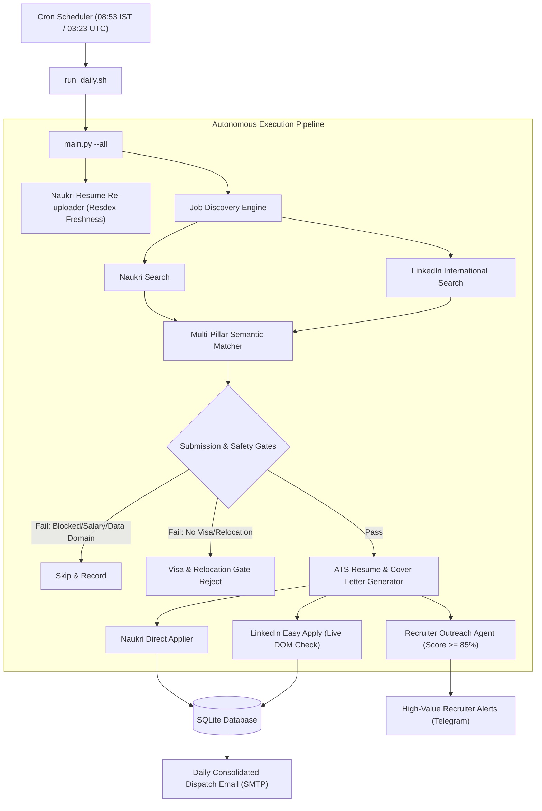

# CareerOps: Autonomous Career Operations Platform (Naukri & LinkedIn)

An enterprise-grade, autonomous career operations platform that orchestrates multi-platform job discovery and applications across **Naukri.com** and **LinkedIn Easy Apply**. It matches opportunities against grounded candidate facts, enforces strict visa sponsorship and relocation gates for international roles, automatically re-uploads candidate CVs for recruiter freshness, drafts high-value executive recruiter pitches, and delivers unified daily email and Telegram briefings.

---

## 🌟 Key Features

### 1. Dual-Platform Autonomous Discovery & Semantic Matching
- **Naukri Pipeline**: Monitors targeted Cloud, OCI, Kubernetes, and AI/GenAI Architecture roles across India.
- **LinkedIn Pipeline**: Continuously searches international opportunities across Europe, the Nordics, Australia, the US, the UK, Canada, Singapore, and the UAE.
- **Multi-Pillar Semantic Qualification**: Evaluates job descriptions against verified candidate competencies (`candidate_facts.yaml`), scoring roles across Architecture, Cloud, OCI, AI/GenAI, Kubernetes, and Security.

### 2. LinkedIn International Easy Apply & Visa/Relocation Gate
- **Strict Visa Sponsorship Gate**: Only applies to international roles that affirmatively confirm employer visa sponsorship for applicants from India.
- **Mandatory Relocation Assistance**: Requires verified employer relocation packages (flight, relocation stipend, housing support).
- **Live Page DOM Pre-Screening**: Reads full job posting text directly from the live page before clicking Easy Apply—automatically disqualifying roles with exclusion clauses (`no sponsorship`, `local candidates only`, `without sponsorship`) or domestic non-sponsorship.
- **Automated Multi-Step Form Resolution**: Navigates multi-step Server-Driven UI (SDUI) modals, selects profile-saved master resumes, and answers screening questionnaires honestly and deterministically.

### 3. Smart Naukri Application Engine
- Headless browser automation via Playwright with anti-bot evasion and persistent session handling.
- Dynamic screening chatbot solver: resolves complex questions (experience tenure, compensation, notice period, certifications).
- Duplicate prevention: checks historical application records and database states to eliminate redundant applications.

### 4. Recruiter Outreach & High-Value Telegram Alerts
- **Executive Outreach Drafting**: Automatically drafts personalized 1-to-1 InMail messages for hiring managers and recruiters on high-match roles (≥85%).
- **Noise-Free Telegram Alerts**: Dispatches instant Telegram notifications strictly for top recruiter outreach opportunities with direct links, plus incoming interview notices—keeping standard application confirmations aggregated in the morning email.

### 5. Daily Profile Freshness Automation
- Automatically re-uploads master CVs to Naukri profile every weekday morning during the peak recruiter screening window (08:53 IST).
- Maximizes Resdex search rank freshness and recruiter profile views.

### 6. Unified Daily Reporting
- Generates a consolidated, responsive HTML and Markdown daily report delivered via SMTP.
- Features side-by-side application breakdown across Naukri, LinkedIn, and direct ATS boards with direct live verification links.

---

## 🏗 Architecture



---

## 🚀 Setup & Installation

### 1. Prerequisites
- Python 3.11+
- Playwright Chromium with Xvfb virtual framebuffer (for headless Linux/VPS execution)
- Linux / macOS / Windows WSL

### 2. Installation
```bash
git clone https://github.com/Saket8/CareerOps.git
cd CareerOps
python3 -m venv venv
source venv/bin/activate
pip install -r requirements.txt
playwright install chromium
```

### 3. Environment Configuration
Copy the configuration template:
```bash
cp .env.example .env
```

Configure `.env`:
```ini
# Naukri Credentials
NAUKRI_USERNAME=your_email@example.com
NAUKRI_PASSWORD=your_password

# LinkedIn Session Configuration (Optional Session Persistence)
LINKEDIN_USERNAME=your_linkedin_email@example.com
LINKEDIN_PASSWORD=your_linkedin_password
LINKEDIN_LI_AT=your_optional_li_at_cookie

# Email Dispatcher (SMTP)
SMTP_USERNAME=your_email@example.com
SMTP_PASSWORD=your_app_password
EMAIL_RECIPIENT=your_email@example.com

# Telegram Alerts (Optional)
TELEGRAM_BOT_TOKEN=your_telegram_bot_token
TELEGRAM_CHAT_ID=your_telegram_chat_id

# Candidate Compensation Truth (LPA - Single Source of Truth)
# Set your current CTC and minimum acceptable salary floor.
# All qualification and discovery gates dynamically resolve against these values.
CURRENT_SALARY_LPA=your_current_ctc_lpa
MIN_ACCEPTABLE_SALARY_LPA=your_min_acceptable_floor_lpa
```

---

## 💻 Usage

### Run Full Weekday Pipeline (Re-upload, Discover, Gate, Apply & Report)
```bash
python main.py --all
```

### Run Specific Tasks
```bash
# Re-upload candidate CV to Naukri profile
python main.py --reupload-cv

# Run job discovery and automated submissions (Naukri + LinkedIn)
python main.py --run-applications

# Dispatch daily summary email report
python main.py --send-report

# Run LinkedIn Easy Apply discovery & application specifically
python -m src.cli.linkedin_cli --discover --apply
```

---

## 🔒 Security & Privacy

- **Confidential Compensation Protection**: Candidate salary and compensation figures are never stored or hardcoded in git. All compensation logic is resolved dynamically from your private `.env` file (Single Source of Truth), keeping the repository 100% shareable and customizable by anyone.
- **Employer Safety Blocklists**: Configurable company blocklists prevent discovery, scoring, or applying to current or conflicting employers.
- **Domain Gate Enforcement**: Strictly excludes non-target domains (e.g., Data Architect, Big Data, Data Engineering) to ensure 100% alignment with verified target tracks (Cloud/OCI & AI/GenAI Architecture).
- **Session Protection**: Active session tokens, cookies, auth states (`artifacts/linkedin_auth.json`, `artifacts/naukri_auth.json`), and SQLite databases are strictly gitignored.

---

## 📄 License
MIT License.
