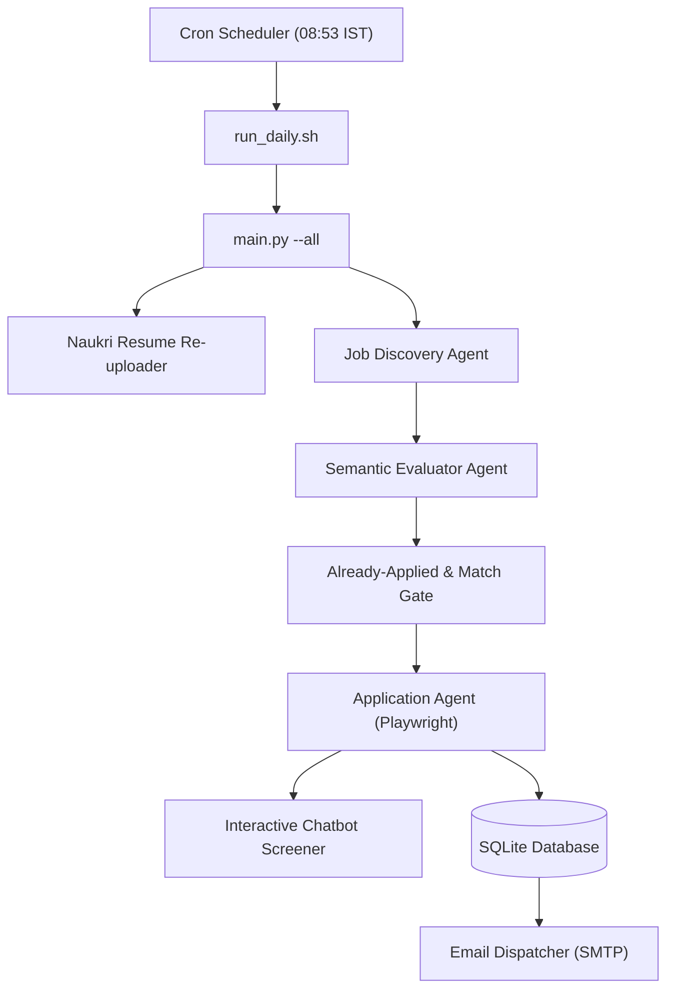

# CareerOps: Autonomous Career Operations Platform

An enterprise-grade, autonomous career operations agent that monitors job portals (Naukri.com), matches opportunities using semantic profile alignment, applies autonomously with human-like screening interactions, automatically re-uploads candidate CVs daily for Resdex ranking freshness, and generates daily dispatch email reports.

---

## 🌟 Key Features

1. **Autonomous Discovery & Semantic Matching**
   - Continuously searches targeted roles (Cloud Architect, OCI Engineer, Kubernetes Specialist).
   - Evaluates job descriptions against grounded candidate facts (`candidate_facts.yaml`), calculating threshold match scores before taking action.

2. **Smart Application Engine**
   - Headless browser automation via Playwright with anti-bot evasion techniques.
   - Dynamic screening chatbot handler: answers screening questions (experience, CTC, notice period, certifications) reliably.
   - Duplicate prevention: checks today's dispatch history and SQLite database to prevent redundant applications.

3. **Daily Resume Freshness Automation**
   - Scheduled automated re-upload of candidate CVs to Naukri profile every weekday morning.
   - Boosts recruiter visibility and Resdex search rankings by keeping the profile actively refreshed.

4. **Profile Optimization & SEO**
   - Live automated updates to Naukri Profile Headline, Executive Profile Summary, and Key Skills.
   - Ensures alignment with high-demand recruiter keywords and character limits.

5. **Automated Daily Reporting**
   - Generates responsive HTML reports summarizing daily applied jobs, match scores, and direct URLs.
   - Dispatches reports via SMTP with evidence tracking.

---

## 🏗 Architecture



---

## 🚀 Setup & Installation

### 1. Prerequisites
- Python 3.11+
- Playwright Chromium with Xvfb virtual framebuffer (for headless VPS execution)
- Linux / macOS / Windows WSL

### 2. Installation
```bash
git clone https://github.com/Saket8/CareerOps.git
cd CareerOps
python3 -m venv venv
source venv/bin/activate
pip install -r requirements.txt
playwright install chromium
```

### 3. Environment Configuration
Copy the template and configure your credentials:
```bash
cp .env.example .env
```
Fill in `.env`:
```ini
# Naukri Credentials
NAUKRI_USERNAME=your_email@example.com
NAUKRI_PASSWORD=your_password

# Email Dispatcher
SMTP_USERNAME=your_email@example.com
SMTP_PASSWORD=your_app_password
EMAIL_RECIPIENT=your_email@example.com
```

---

## 💻 Usage

### Run Full Daily Cycle (Re-upload, Match, Apply & Report)
```bash
python main.py --all
```

### Run Specific Tasks
```bash
# Re-upload candidate CV only
python main.py --reupload-cv

# Run job discovery & applications
python main.py --run-applications

# Dispatch daily summary report
python main.py --send-report
```

---

## 🔒 Security & Privacy
- Sensitive credentials (`.env`), session tokens (`artifacts/naukri_auth.json`), and application databases are strictly gitignored.
- Never commit active credentials or personal auth states.

---

## 📄 License
MIT License.
