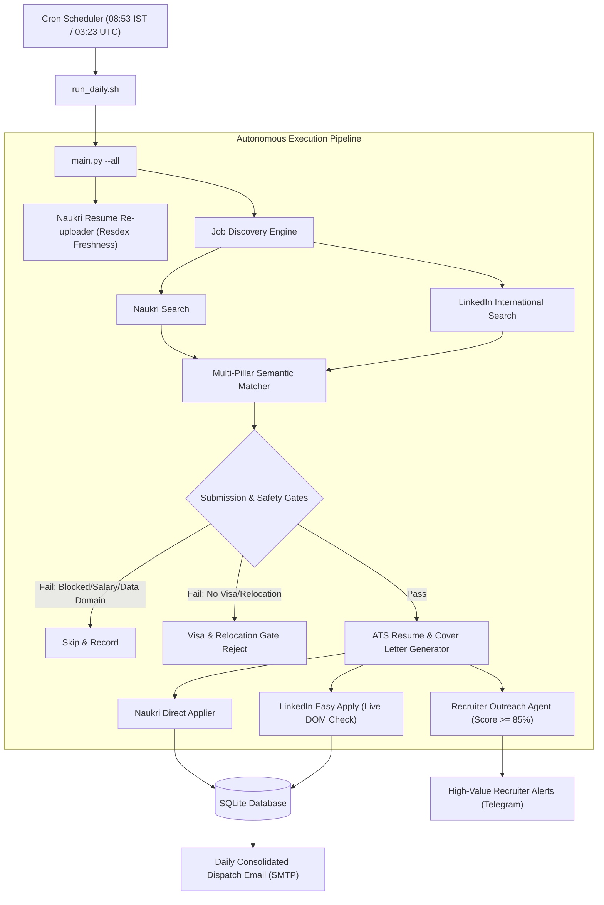

# CareerOps: Autonomous Career Operations Platform (Naukri & LinkedIn)

An enterprise-grade, autonomous career operations platform that orchestrates multi-platform job discovery and applications across **Naukri.com** and **LinkedIn Easy Apply**. It matches opportunities against grounded candidate facts, enforces strict visa sponsorship and relocation gates for international roles, automatically re-uploads candidate CVs for recruiter freshness, drafts high-value executive recruiter pitches, and delivers unified daily email and Telegram briefings.

---

## ☁️ Zero-Cost 24/7 Cloud Hosting: Procuring an OCI Always Free Linux Server

To run CareerOps 24/7 autonomously without keeping your personal computer running or paying monthly AWS/GCP bills, host it on **Oracle Cloud Infrastructure (OCI) Always Free Tier** at **$0/month forever**.

### Why OCI Always Free?
- **Industry-Leading Compute Specs**:
  - **Ampere A1 Compute (Arm)**: Up to **4 OCPUs** and **24 GB RAM** (can run as 1 large VM or split into up to 4 smaller VMs).
  - **AMD Micro Compute (x86_64)**: Up to **2 instances** of `VM.Standard.E2.1.Micro` (1 OCPU, 1 GB RAM each).
- **Free Persistent Storage & Bandwidth**: **200 GB Block Volume storage** (NVMe SSD) and **10 TB/month outbound data transfer**.
- **Static Public IP**: Free dedicated public IPv4 address per compute instance.
- **Permanent $0 Cost**: Always Free resources do not expire and never incur charges as long as usage remains within the free tier thresholds.

---

### Step-by-Step Procurement & Setup Walkthrough

#### Step 1: Register for an OCI Always Free Account
1. Visit the [Oracle Cloud Free Tier Registration](https://signup.cloud.oracle.com/).
2. Provide your email, country/region, and account name.
3. Select your **Home Region** carefully (e.g., *India West (Mumbai)*, *India South (Hyderabad)*, *US East (Ashburn)*, or *Europe (Frankfurt)*).  
   > [!IMPORTANT]
   > Always Free compute instances and storage volumes must reside in your selected **Home Region**.
4. Complete the credit/debit card identity verification (a small temporary verification hold is placed and immediately released; you will **not** be billed).

#### Step 2: Provision Your Always Free Linux Compute Instance
1. Log in to the [Oracle Cloud Console](https://cloud.oracle.com/).
2. In the navigation menu (top-left hamburger), go to **Compute** > **Instances**, then click **Create Instance**.
3. Configure the VM specifications:
   - **Name**: e.g., `careerops-prod`
   - **Compartment**: Select your default root compartment.
   - **Placement**: Keep the default Availability Domain.
   - **Image and Shape**:
     - Click **Change Image**: Choose **Oracle Linux 8 / 9** (recommended) or **Ubuntu 22.04 / 24.04 LTS**.
     - Click **Change Shape**:
       - *Option A (Recommended - Maximum Performance)*: Select **Ampere (Arm Processor)** > `VM.Standard.A1.Flex`. Allocate **2 to 4 OCPUs** and **12 to 24 GB RAM** (marked with the *Always Free Eligible* badge).
       - *Option B (Standard x86 Architecture)*: Select **Specialty and Previous Generation** > **AMD** > `VM.Standard.E2.1.Micro` (1 OCPU, 1 GB RAM, *Always Free Eligible*).
   - **Networking**:
     - Choose **Create new virtual cloud network** (or use an existing VCN).
     - Choose **Create new public subnet**.
     - Ensure **Assign a public IPv4 address** is set to **Yes**.
   - **Add SSH Keys**:
     - Select **Generate a key pair for me** and click **Save Private Key** to download `ssh-key-*.key`, OR select **Upload public key files** to upload your existing `~/.ssh/id_rsa.pub` or `~/.ssh/id_ed25519.pub`.
   - **Boot Volume**: Keep default (46.6 GB up to 200 GB Always Free).
4. Click **Create**. The instance status will transition from `PROVISIONING` to `RUNNING` within ~30–60 seconds. Note down your **Public IP Address** from the Instance Details screen.

#### Step 3: Connect to Your OCI Server via SSH
Open your local terminal and connect using your downloaded SSH private key:

```bash
# Restrict private key permissions
chmod 400 ~/Downloads/ssh-key-*.key

# Connect via SSH:
# For Oracle Linux (default user: opc)
ssh -i ~/Downloads/ssh-key-*.key opc@<YOUR_INSTANCE_PUBLIC_IP>

# For Ubuntu (default user: ubuntu)
ssh -i ~/Downloads/ssh-key-*.key ubuntu@<YOUR_INSTANCE_PUBLIC_IP>
```

#### Step 4: Install System Dependencies & Virtual Framebuffer (Xvfb)
Playwright Chromium requires standard X11 and rendering libraries to operate headlessly on cloud servers without a desktop environment:

**For Oracle Linux / RHEL / Rocky Linux (user `opc`):**
```bash
sudo dnf update -y
sudo dnf install -y python3.11 python3.11-pip git xorg-x11-server-Xvfb \
    alsa-lib atk at-spi2-atk gtk3 libdrm libXcomposite libXdamage \
    libXrandr libxkbcommon mesa-libgbm pango
```

**For Ubuntu / Debian (user `ubuntu`):**
```bash
sudo apt update && sudo apt upgrade -y
sudo apt install -y python3.11 python3.11-venv python3-pip git xvfb \
    libgbm-dev libnss3 libatk-bridge2.0-0 libgtk-3-0 libasound2
```

#### Step 5: Clone & Initialize CareerOps
```bash
# Clone the repository
git clone https://github.com/Saket8/CareerOps.git
cd CareerOps

# Create and activate Python virtual environment
python3.11 -m venv venv
source venv/bin/activate

# Install Python requirements and Chromium headless browser binaries
pip install --upgrade pip
pip install -r requirements.txt
playwright install chromium
playwright install-deps chromium
```

#### Step 6: Configure Environment & Candidate Facts
```bash
# Create and populate your production environment file
cp .env.example .env
nano .env

# Customize your target tracks, skills, and screening preferences
nano config/candidate_facts.yaml
nano config/config.yaml
```
*(All salary fields in `.env.example` are generic placeholders; set your personal CTC and floor thresholds in `.env` securely on your private server).*

#### Step 7: Configure 24/7 Automated Scheduling via System Cron
To ensure robust, unattended execution immune to user crontab resets, configure a system cron job under `/etc/cron.d/careerops`:

```bash
sudo tee /etc/cron.d/careerops << 'EOF'
SHELL=/bin/bash
PATH=/usr/local/sbin:/usr/local/bin:/sbin:/bin:/usr/sbin:/usr/bin

# CareerOps Weekday Morning Pipeline (08:53 IST / 03:23 UTC)
# Automates CV re-upload, job discovery, visa/relocation gating, applications & daily reporting
23 3 * * 1-5 opc cd /u01/CareerOps && /usr/bin/xvfb-run -a /u01/CareerOps/venv/bin/python main.py --all >> /u01/CareerOps/logs/cron.log 2>&1
EOF

sudo chmod 0644 /etc/cron.d/careerops
```
*(Note: If hosting on Ubuntu or a different directory, adjust `opc` to `ubuntu` and `/u01/CareerOps` to your clone directory).*

---

## 🌟 Key Features

### 1. Dual-Platform Autonomous Discovery & Semantic Matching
- **Naukri Pipeline**: Monitors targeted Cloud, OCI, Kubernetes, and AI/GenAI Architecture roles across India.
- **LinkedIn Pipeline**: Continuously searches international opportunities across Europe, the Nordics, Australia, the US, the UK, Canada, Singapore, and the UAE.
- **Multi-Pillar Semantic Qualification**: Evaluates job descriptions against verified candidate competencies (`candidate_facts.yaml`), scoring roles across Architecture, Cloud, OCI, AI/GenAI, Kubernetes, and Security.

### 2. LinkedIn International Easy Apply & Visa/Relocation Gate
- **Strict Visa Sponsorship Gate**: Only applies to international roles that affirmatively confirm employer visa sponsorship for applicants from India.
- **Mandatory Relocation Assistance**: Requires verified employer relocation packages (flight, relocation stipend, housing support).
- **Live Page DOM Pre-Screening**: Reads full job posting text directly from the live page before clicking Easy Apply—automatically disqualifying roles with exclusion clauses (`no sponsorship`, `local candidates only`, `without sponsorship`) or domestic non-sponsorship.
- **Automated Multi-Step Form Resolution**: Navigates multi-step Server-Driven UI (SDUI) modals, selects profile-saved master resumes, and answers screening questionnaires honestly and deterministically.

### 3. Smart Naukri Application Engine
- Headless browser automation via Playwright with anti-bot evasion and persistent session handling.
- Dynamic screening chatbot solver: resolves complex questions (experience tenure, compensation, notice period, certifications).
- Duplicate prevention: checks historical application records and database states to eliminate redundant applications.

### 4. Recruiter Outreach & High-Value Telegram Alerts
- **Executive Outreach Drafting**: Automatically drafts personalized 1-to-1 InMail messages for hiring managers and recruiters on high-match roles (≥85%).
- **Noise-Free Telegram Alerts**: Dispatches instant Telegram notifications strictly for top recruiter outreach opportunities with direct links, plus incoming interview notices—keeping standard application confirmations aggregated in the morning email.

### 5. Daily Profile Freshness Automation
- Automatically re-uploads master CVs to Naukri profile every weekday morning during the peak recruiter screening window (08:53 IST).
- Maximizes Resdex search rank freshness and recruiter profile views.

### 6. Unified Daily Reporting
- Generates a consolidated, responsive HTML and Markdown daily report delivered via SMTP.
- Features side-by-side application breakdown across Naukri, LinkedIn, and direct ATS boards with direct live verification links.

---

## 🏗 Architecture



---

## 🚀 Setup & Installation

### 1. Prerequisites
- Python 3.11+
- Playwright Chromium with Xvfb virtual framebuffer (for headless Linux/VPS execution)
- Linux / macOS / Windows WSL

### 2. Installation
```bash
git clone https://github.com/Saket8/CareerOps.git
cd CareerOps
python3 -m venv venv
source venv/bin/activate
pip install -r requirements.txt
playwright install chromium
```

### 3. Environment Configuration
Copy the configuration template:
```bash
cp .env.example .env
```

Configure `.env`:
```ini
# Naukri Credentials
NAUKRI_USERNAME=your_email@example.com
NAUKRI_PASSWORD=your_password

# LinkedIn Session Configuration (Optional Session Persistence)
LINKEDIN_USERNAME=your_linkedin_email@example.com
LINKEDIN_PASSWORD=your_linkedin_password
LINKEDIN_LI_AT=your_optional_li_at_cookie

# Email Dispatcher (SMTP)
SMTP_USERNAME=your_email@example.com
SMTP_PASSWORD=your_app_password
EMAIL_RECIPIENT=your_email@example.com

# Telegram Alerts (Optional)
TELEGRAM_BOT_TOKEN=your_telegram_bot_token
TELEGRAM_CHAT_ID=your_telegram_chat_id

# Candidate Compensation Truth (LPA - Single Source of Truth)
# Set your current CTC and minimum acceptable salary floor.
# All qualification and discovery gates dynamically resolve against these values.
CURRENT_SALARY_LPA=your_current_ctc_lpa
MIN_ACCEPTABLE_SALARY_LPA=your_min_acceptable_floor_lpa
```

---

## 💻 Usage

### Run Full Weekday Pipeline (Re-upload, Discover, Gate, Apply & Report)
```bash
python main.py --all
```

### Run Specific Tasks
```bash
# Re-upload candidate CV to Naukri profile
python main.py --reupload-cv

# Run job discovery and automated submissions (Naukri + LinkedIn)
python main.py --run-applications

# Dispatch daily summary email report
python main.py --send-report

# Run LinkedIn Easy Apply discovery & application specifically
python -m src.cli.linkedin_cli --discover --apply
```

---

## 🛠️ User Customization Guide: Tailor to Any Profile & Preference

CareerOps is built to be 100% modular and adaptable to any candidate, tech stack, or geographic preference. Feel free to customize the settings below:

### 1. Domestic Jobs in India vs. International Relocation (LinkedIn)

Depending on where you live and where you want to work, configure the LinkedIn gate in [`config/config.yaml`](config/config.yaml):

#### Scenario A: You Want International Roles Offering Visa Sponsorship & Relocation (Current Default)
If you are located in India (or elsewhere) and strictly want international roles that sponsor your work visa and pay for relocation:
```yaml
# config/config.yaml
linkedin:
  require_visa_sponsorship: true   # Strictly requires affirmative visa sponsorship
  require_relocation: true          # Strictly requires relocation assistance
  target_regions:
    - name: "Europe"
      location: "Europe"
    - name: "Nordics"
      location: "Nordics"
    - name: "Australia"
      location: "Australia"
    - name: "United States"
      location: "United States"
    - name: "United Kingdom"
      location: "United Kingdom"
    - name: "Canada"
      location: "Canada"
    - name: "Singapore"
      location: "Singapore"
    - name: "UAE"
      location: "United Arab Emirates"
```

#### Scenario B: You Prefer Domestic Jobs in India on LinkedIn
If you want to apply to domestic Indian jobs via LinkedIn Easy Apply (no visa sponsorship or relocation required):
```yaml
# config/config.yaml
linkedin:
  require_visa_sponsorship: false  # Disable international visa requirement
  require_relocation: false         # Disable relocation package requirement
  target_regions:
    - name: "India"
      location: "India"
    - name: "Pan India"
      location: "India"
    - name: "Bengaluru"
      location: "Bengaluru"
    - name: "Noida"
      location: "Noida"
    - name: "Delhi NCR"
      location: "Delhi NCR"
    - name: "Hyderabad"
      location: "Hyderabad"
    - name: "Pune"
      location: "Pune"
```

#### Scenario C: Local Citizen / Resident in the US, UK, or EU
If you already possess unrestricted work authorization in your target country (e.g., US citizen/Green Card in the US, EU citizen in Europe):
- Set `require_visa_sponsorship: false` and `require_relocation: false` in `config/config.yaml`.
- Set `target_regions` to your target countries or metro regions.
- Update `work_authorization` in [`candidate/candidate_facts.yaml`](candidate/candidate_facts.yaml) (e.g. `US Citizen`, `EU Permanent Resident`).

---

### 2. Customizing Your Tech Stack & Search Queries

CareerOps currently targets Cloud, OCI, and AI/GenAI Architecture, but can be adapted for any engineering discipline in [`config/config.yaml`](config/config.yaml):

```yaml
# config/config.yaml
search:
  queries:
    # Example 1: AWS / Azure Cloud Engineering
    aws_azure_cloud:
      - "Principal AWS Solutions Architect"
      - "Lead Azure Cloud Architect"
      - "Cloud Infrastructure Architect"

    # Example 2: DevOps, SRE & Platform Engineering
    devops_sre:
      - "Lead SRE / Site Reliability Engineer"
      - "Staff Platform Engineer"
      - "Kubernetes Architect"

    # Example 3: Full-Stack / Backend Engineering
    backend_development:
      - "Staff Backend Engineer (Python / Go)"
      - "Principal Software Engineer (Java / Distributed Systems)"

    # Example 4: Data Engineering (If you ARE a Data Architect/Engineer)
    # Note: If targeting data roles, remember to remove 'data architect' from safety.excluded_job_titles!
    data_engineering:
      - "Principal Data Architect"
      - "Lead Data Platform Engineer"
```

Update your LinkedIn search queries accordingly:
```yaml
linkedin:
  queries:
    - "Principal AWS Architect"
    - "Lead DevOps Engineer"
    - "Staff Platform Engineer"
```

---

### 3. Setting Your Compensation Bracket & CTC Floor (`.env`)

All compensation evaluation is handled securely and dynamically via your private `.env` file without revealing salary in code:

```ini
# .env (Single Source of Truth)
CURRENT_SALARY_LPA=            # Your current CTC in LPA
MIN_ACCEPTABLE_SALARY_LPA=     # Minimum acceptable salary threshold in LPA
```

- **Underpaying Job Filter**: Any job disclosing a maximum compensation lower than `MIN_ACCEPTABLE_SALARY_LPA` is automatically marked as `SALARY_REJECTED` during discovery.
- **Undisclosed Salaries**: Jobs with undisclosed or negotiable salaries are automatically accepted for qualification so you never miss top-tier unadvertised packages (`undisclosed_salary_allowed: true`).
- **Flexible Ranges**: Ranges spanning above your threshold (e.g. ranges meeting your configured threshold floor) are automatically accepted.

---

### 4. Updating Your Candidate Profile Facts & Master Resume

All profile matching, screening questions, and dynamic resume tailoring rely on Grounded Truth:

1. **Master Resume**:
   - Place your primary resume in [`resumes/master/`](resumes/master/) (e.g. `resumes/master/John_Doe_Cloud_Architect.docx`).
   - Update `resume.source_path` in `config/config.yaml`.

2. **Candidate Profile Facts ([`candidate/candidate_facts.yaml`](candidate/candidate_facts.yaml))**:
   Edit your verified identity, tenure, and preferences:
   ```yaml
   candidate:
     name: "Your Name"
     title: "Your Target Role"
     email: "your_email@example.com"
     phone: "+91-9876543210"
     location: "Bengaluru, India"
     preferred_locations: ["Bengaluru", "Remote", "Hybrid"]
     total_experience_years: 10.0
     notice_period_days: 60
     willing_to_relocate: true
     work_authorization: "Indian Citizen"
   ```

3. **Verified Competencies**:
   Populate your primary platforms, tools, and certifications under `verified_competencies` in `candidate_facts.yaml`. The agent will strictly tailor ATS resumes based on these verified facts with zero hallucination.

---

### 5. Safety Blocklists & Domain Exclusions

Protect your current employer and filter out unwanted job titles in [`config/config.yaml`](config/config.yaml):

```yaml
safety:
  # 1. Employer Safety Blocklist (Never search or apply to your current employer)
  blocked_companies:
    - "Your Current Employer"
    - "Subsidiary Company Name"

  # 2. Excluded Job Titles & Domains
  # Add titles you want to strictly reject (e.g., Data Architect, Sales, Support)
  excluded_job_titles:
    - "data architect"
    - "data engineer"
    - "sales engineer"
    - "technical support"
    - "snowflake"
    - "databricks"
```

> [!TIP]
> **If you ARE a Data Architect or Data Engineer:** Simply remove `"data architect"` and `"data engineer"` from `excluded_job_titles`! The gate will immediately permit data roles to qualify and apply.

---

### 6. Tuning Application Quotas, Match Thresholds & Dry-Run Mode

```yaml
# config/config.yaml
application:
  match_threshold: 70.0          # Minimum semantic match score (%) required to apply
  high_match_threshold: 85.0     # Score threshold triggering executive recruiter cover letters & drafts
  max_applications_per_day: 25   # Daily hard cap on submitted applications
  max_run_duration_seconds: 3600 # 60-minute hard ceiling per run to prevent lingering processes
  dry_run: false                 # Set to 'true' for dry-run simulation
```

- **Testing Safely in Dry-Run Mode**:
  Run in dry-run mode before going live to verify discovery, scoring, and tailored resume generation without submitting any real applications:
  ```bash
  DRY_RUN=true python main.py --all
  ```

---

### 7. Notification Channels (Email & Telegram)

- **Email Reports**: Enter your destination email in `.env` (`EMAIL_RECIPIENT=your_email@example.com`). Generates a consolidated HTML report summarizing daily submissions, match scores, and direct job links.
- **Telegram Notifications**: Create a bot via [@BotFather](https://t.me/BotFather) and set `TELEGRAM_BOT_TOKEN` and `TELEGRAM_CHAT_ID` in `.env`. Receive real-time alerts strictly for recruiter outreach drafts (≥85% match) and incoming interview invitations.

---

## 🔒 Security & Privacy

- **Confidential Compensation Protection**: Candidate salary and compensation figures are never stored or hardcoded in git. All compensation logic is resolved dynamically from your private `.env` file (Single Source of Truth), keeping the repository 100% shareable and customizable by anyone.
- **Employer Safety Blocklists**: Configurable company blocklists prevent discovery, scoring, or applying to current or conflicting employers.
- **Domain Gate Enforcement**: Strictly excludes non-target domains (e.g., Data Architect, Big Data, Data Engineering) to ensure 100% alignment with verified target tracks (Cloud/OCI & AI/GenAI Architecture).
- **Session Protection**: Active session tokens, cookies, auth states (`artifacts/linkedin_auth.json`, `artifacts/naukri_auth.json`), and SQLite databases are strictly gitignored.

---

## 📄 License
MIT License.
