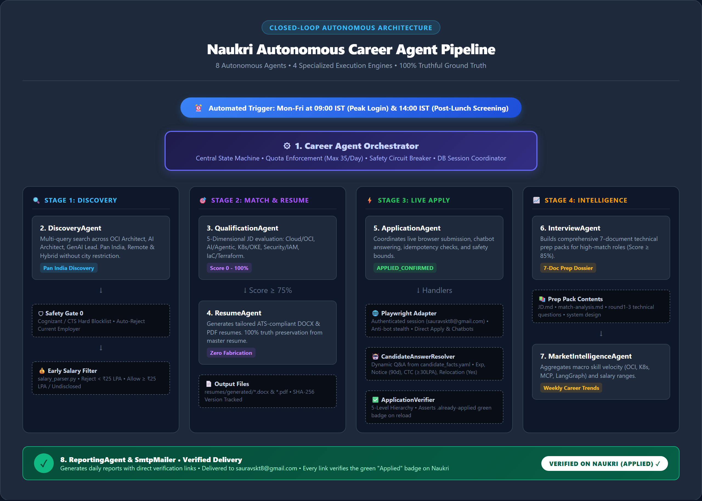

# CareerOps — Autonomous Multi-Agent Career & Opportunity Operations Platform

[](agents_flowchart.html)

**CareerOps** is an autonomous, production-grade agentic platform designed for continuous career operations, opportunity discovery, truth-grounded resume tailoring, live multi-portal applications, and executive interview intelligence.

Initially launched with deep **Naukri** automation, CareerOps is engineered with a modular, portal-agnostic design ready for upcoming **LinkedIn** and multi-platform adapters.

1. **Autonomous Execution**: Runs automatically Monday–Friday at 09:00 IST via GitHub Actions with persistent SQLite state (swappable to PostgreSQL or OCI Autonomous Database).
2. **Hard Salary Eligibility Filter**:
   - Disclosed minimum $\ge$ **₹20 LPA** $\rightarrow$ **ACCEPT** (e.g. ₹20–30 LPA, ₹25–40 LPA, ₹30+ LPA)
   - Disclosed minimum $<$ **₹20 LPA** $\rightarrow$ **REJECT** immediately (e.g. ₹15–25 LPA, ₹18–30 LPA are rejected regardless of upper bound)
   - Salary Undisclosed $\rightarrow$ **ACCEPT** for full qualification
3. **Candidate Truth Layer (Zero Hallucination)**:
   - Grounded strictly in the immutable master resume ([`Saket_Saurav_OCI.docx`](resumes/master/Saket_Saurav_OCI.docx)).
   - Enforces `candidate/candidate_facts.yaml` schema: 12+ years total IT experience, 6+ years OCI specialization, 6 verified Oracle professional certifications.
   - **Never** fabricates experience, employers, dates, or credentials.
4. **ATS Resume Engine & Validator**:
   - Generates tailored, clean `.docx` and companion `.pdf` (`Company_Role_YYYYMMDD.docx/.pdf`).
   - ATS validator verifies text extractability, standard section headings, contact details, zero fabrication, and safe keyword density.
5. **Safe Autonomous Application Engine**:
   - No human gate for qualifying applications (Match $\ge 75\%$, salary eligible, truthful facts available, deduplicated).
   - **Exception Safety Boundary**: Halts immediately on CAPTCHA, MFA/OTP, bot detection, or payment walls without evasion, marking status as `BLOCKED`.
   - Default `DRY_RUN=true` mode ensures complete pipeline verification without accidental live applications.
6. **Interview Intelligence Agent & Simulator**:
   - For strong matches ($\ge 85\%$), automatically generates a 7-document interview pack (`JD.md`, `match-analysis.md`, `likely-questions.md`, `model-answers.md`, `architecture-exercises.md`, `candidate-gaps.md`, `7-day-preparation-plan.md`).
   - Evaluates across **Level 1 (Knowledge)**, **Level 2 (Architecture)**, and **Level 3 (Principal Architect with cross-questioning)**.
   - Interactive CLI simulator for practice (`python scripts/interview_simulator.py`).
7. **Market Signal Engine & Weekly Career Intelligence**:
   - Aggregates collected JD data to classify skill trends ($\uparrow$ Increasing, $\downarrow$ Decreasing, $\rightarrow$ Stable, NEW, DISAPPEARING).
   - Delivers daily execution HTML reports and comprehensive Friday career intelligence briefings via email.

---

## 📁 Repository Structure

```
CareerOps/
├── .github/workflows/
│   └── career_agent_daily.yml         # GitHub Actions Mon-Fri 09:00 IST cron
├── candidate/
│   ├── candidate_facts.yaml           # Schema-enforced candidate truth layer
│   └── profile_extractor.py          # Master resume parser & truth validator
├── config/
│   └── config.yaml                    # Production thresholds, 36+ queries, email & safety
├── resumes/
│   ├── master/
│   │   └── Saket_Saurav_OCI.docx      # Immutable ground truth source
│   └── generated/                     # Job-specific ATS-tailored DOCX & PDF resumes
├── reports/
│   ├── daily/                         # Daily Markdown & HTML execution reports
│   └── weekly/                        # Friday Weekly Career Intelligence briefings
├── interviews/
│   └── <company>/<role>/              # 7-document interview packs
├── src/
│   ├── agents/
│   │   ├── orchestrator.py            # Central workflow and state machine coordinator
│   │   ├── discovery.py               # Search, deduplication, and early salary filter
│   │   ├── qualification.py           # Multi-dimensional scoring & evidence extraction
│   │   ├── resume_agent.py            # ATS resume tailor, DOCX/PDF builder, validator
│   │   ├── application.py             # Autonomous application engine & safety boundaries
│   │   ├── interview_agent.py         # 3-level interview pack generator
│   │   ├── market_intelligence.py     # Skill frequencies, velocity & recommendations
│   │   └── reporting.py               # Responsive HTML & Markdown report builder
│   ├── database/
│   │   ├── connection.py              # SQLAlchemy engine & session factory
│   │   ├── models.py                  # Database tables (jobs, applications, scores, etc.)
│   │   └── repositories/              # Repository pattern implementations
│   ├── naukri/
│   │   ├── interface.py               # Abstract Naukri client & safety exceptions
│   │   └── browser_adapter.py         # Safe browser/HTTP adapter with offline fallback
│   ├── email_service/
│   │   └── smtp_mailer.py             # Secure HTML email dispatcher with retry
│   ├── models/                        # Pydantic schemas (job, score, candidate, report)
│   └── utils/
│       ├── logger.py                  # Sanitized logging (masks credentials, secrets)
│       └── salary_parser.py           # Strict INR/LPA parsing and ₹20 LPA rule
├── scripts/
│   └── interview_simulator.py         # Interactive terminal interview practice tool
├── tests/
│   ├── unit/                          # 40+ unit tests across all agent components
│   └── integration/                   # Full end-to-end dry-run integration test
└── main.py                            # CLI entrypoint
```

---

## 🛠️ Usage & Execution

### 1. Run the Test Suite
```bash
python -m pytest
```

### 2. Run Daily Pipeline (Dry Run Mode - Default)
```bash
python main.py
```

### 3. Run with Offline Mock Data & Force Weekly Report
```bash
python main.py --offline --weekly
```

### 4. Interactive Interview Simulator
```bash
python scripts/interview_simulator.py
```

---

## 🔐 GitHub Secrets Configuration

For scheduled automated runs in GitHub Actions, configure the following secrets under **Repository Settings $\rightarrow$ Secrets and variables $\rightarrow$ Actions**:

| Secret Name | Description |
|---|---|
| `NAUKRI_USERNAME` | Your registered Naukri login email |
| `NAUKRI_PASSWORD` | Your registered Naukri password |
| `SMTP_USERNAME` | SMTP sender email (e.g. Gmail address) |
| `SMTP_PASSWORD` | SMTP app-specific password |
| `EMAIL_RECIPIENT` | Target recipient for daily/weekly reports |
| `OPENAI_API_KEY` | (Optional) For external LLM integrations |
