# CareerOps: Autonomous Career Operations Platform (Naukri & LinkedIn)

An enterprise-grade, autonomous career operations platform that orchestrates multi-platform job discovery and applications across **Naukri.com** and **LinkedIn Easy Apply**. It matches opportunities against grounded candidate facts, enforces strict visa sponsorship and relocation gates for international roles, automatically re-uploads candidate CVs for recruiter freshness, drafts high-value executive recruiter pitches, and delivers unified daily email and Telegram briefings.

---

## ☁️ Zero-Cost 24/7 Cloud Hosting: OCI Always Free Linux Server

To run CareerOps 24/7 autonomously at $0/month forever without paying cloud bills, host it on an **Oracle Cloud Infrastructure (OCI) Always Free** Linux compute instance.

### Recommended Always Free Instance Specs
- **Compute Shape**:
  - **Ampere A1 Flex (Arm)** *(Recommended)*: Up to **4 OCPUs & 24 GB RAM** (`VM.Standard.A1.Flex`, 100% Always Free).
  - **AMD Micro (x86_64)**: Up to 2 instances of `VM.Standard.E2.1.Micro` (1 OCPU & 1 GB RAM each).
- **OS**: **Oracle Linux 8 / 9** (default user: `opc`) or **Ubuntu 22.04 / 24.04 LTS** (default user: `ubuntu`).
- **Free Storage & Bandwidth**: 200 GB NVMe Block Volume, static public IPv4, and 10 TB/month outbound data transfer.

---

### Quick Deployment

#### Step 1: Provision & Connect via SSH
1. In the [OCI Console](https://cloud.oracle.com/) (Compute → Instances → Create Instance), launch an instance with **Oracle Linux 9** (or Ubuntu LTS) and shape **VM.Standard.A1.Flex** (or `VM.Standard.E2.1.Micro`).
2. Attach your SSH public key and ensure **Assign a public IPv4 address** is selected.
3. Connect from your local terminal:
```bash
# Oracle Linux (user: opc)
ssh -i /path/to/ssh-key.key opc@<YOUR_INSTANCE_PUBLIC_IP>

# Ubuntu (user: ubuntu)
ssh -i /path/to/ssh-key.key ubuntu@<YOUR_INSTANCE_PUBLIC_IP>
```

#### Step 2: Install System Dependencies & Virtual Framebuffer (Xvfb)
Playwright Chromium requires standard X11 rendering libraries to operate headlessly on cloud servers:

**For Oracle Linux / RHEL / Rocky Linux (user `opc`):**
```bash
sudo dnf update -y
sudo dnf install -y python3.11 python3.11-pip git xorg-x11-server-Xvfb \
    alsa-lib atk at-spi2-atk gtk3 libdrm libXcomposite libXdamage \
    libXrandr libxkbcommon mesa-libgbm pango
```

**For Ubuntu / Debian (user `ubuntu`):**
```bash
sudo apt update && sudo apt upgrade -y
sudo apt install -y python3.11 python3.11-venv python3-pip git xvfb \
    libgbm-dev libnss3 libatk-bridge2.0-0 libgtk-3-0 libasound2
```

#### Step 3: Clone & Initialize CareerOps
```bash
# Clone the repository
git clone https://github.com/Saket8/CareerOps.git
cd CareerOps

# Create and activate Python virtual environment
python3.11 -m venv venv
source venv/bin/activate

# Install Python requirements and Chromium headless browser binaries
pip install --upgrade pip
pip install -r requirements.txt
playwright install chromium
playwright install-deps chromium
```

#### Step 4: Configure Environment & Candidate Facts
```bash
# Create and populate your production environment file
cp .env.example .env
nano .env

# Customize your target tracks, skills, and screening preferences
nano config/candidate_facts.yaml
nano config/config.yaml
```
*(All salary fields in `.env.example` are generic placeholders; set your personal CTC and floor thresholds in `.env` securely on your private server).*

#### Step 5: Configure 24/7 Automated Scheduling via System Cron
To ensure robust, unattended execution immune to user crontab resets, configure a system cron job under `/etc/cron.d/careerops`:

```bash
sudo tee /etc/cron.d/careerops << 'EOF'
SHELL=/bin/bash
PATH=/usr/local/sbin:/usr/local/bin:/sbin:/bin:/usr/sbin:/usr/bin

# CareerOps Daily Morning Pipeline (08:53 IST / 03:23 UTC)
# Mon-Fri: Automates CV re-upload, job discovery, visa/relocation gating, applications (<=20) & daily reporting
# Sat-Sun: Re-uploads master CV to Naukri profile only to preserve Resdex search freshness (no applications)
23 3 * * * opc /u01/CareerOps/run_daily.sh
EOF

sudo chmod 0644 /etc/cron.d/careerops
```
*(Note: If hosting on Ubuntu or a different directory, adjust `opc` to `ubuntu` and `/u01/CareerOps` to your clone directory).*

---

## 🌟 Key Features

### 1. Dual-Platform Autonomous Discovery & Semantic Matching
- **Naukri Pipeline**: Monitors targeted Cloud, OCI, Kubernetes, and AI/GenAI Architecture roles across India.
- **LinkedIn Pipeline**: Continuously searches international opportunities across Europe, the Nordics, Australia, the US, the UK, Canada, Singapore, and the UAE.
- **Multi-Pillar Semantic Qualification**: Evaluates job descriptions against verified candidate competencies (`candidate_facts.yaml`), scoring roles across Architecture, Cloud, OCI, AI/GenAI, Kubernetes, and Security.

### 2. LinkedIn International Easy Apply & Visa/Relocation Gate
- **Strict Visa Sponsorship Gate**: Only applies to international roles that affirmatively confirm employer visa sponsorship for applicants from India.
- **Configurable Relocation Assistance**: Optionally filters for verified employer relocation packages (flight, stipend, housing) or treats relocation as a bonus (`require_relocation: false`).
- **Live Page DOM Pre-Screening**: Reads full job posting text directly from the live page before clicking Easy Apply—automatically disqualifying roles with exclusion clauses (`no sponsorship`, `local candidates only`, `without sponsorship`) or domestic non-sponsorship.
- **Automated Multi-Step Form Resolution**: Navigates multi-step Server-Driven UI (SDUI) modals, selects profile-saved master resumes, and answers screening questionnaires honestly and deterministically.

### 3. Smart Naukri Application Engine
- Headless browser automation via Playwright with anti-bot evasion and persistent session handling.
- Dynamic screening chatbot solver: resolves complex questions (experience tenure, compensation, notice period, certifications).
- Duplicate prevention: checks historical application records and database states to eliminate redundant applications.

### 4. Recruiter Outreach & High-Value Telegram Alerts
- **Executive Outreach Drafting**: Automatically drafts personalized 1-to-1 InMail messages for hiring managers and recruiters on high-match roles (≥85%).
- **Noise-Free Telegram Alerts**: Dispatches instant Telegram notifications strictly for top recruiter outreach opportunities with direct links, plus incoming interview notices—keeping standard application confirmations aggregated in the morning email.

### 5. Daily Profile Freshness Automation
- Automatically re-uploads master CVs to Naukri profile every weekday morning during the peak recruiter screening window (08:53 IST).
- Maximizes Resdex search rank freshness and recruiter profile views.

### 6. Unified Daily Reporting
- Generates a consolidated, responsive HTML and Markdown daily report delivered via SMTP.
- Features side-by-side application breakdown across Naukri, LinkedIn, and direct ATS boards with direct live verification links.

---

## 🏗 Architecture

```mermaid
flowchart TD
    %% Global Styling Classes
    classDef trigger fill:#e0f2fe,stroke:#0284c7,stroke-width:2px,color:#0369a1;
    classDef booster fill:#fef3c7,stroke:#d97706,stroke-width:2px,color:#b45309;
    classDef discovery fill:#f3e8ff,stroke:#9333ea,stroke-width:2px,color:#6b21a8;
    classDef gate fill:#fee2e2,stroke:#dc2626,stroke-width:2px,color:#b91c1c;
    classDef qualify fill:#ecfdf5,stroke:#059669,stroke-width:2px,color:#047857;
    classDef apply fill:#fdf4ff,stroke:#c026d3,stroke-width:2px,color:#86198f;
    classDef outreach fill:#ffedd5,stroke:#ea580c,stroke-width:2px,color:#c2410c;
    classDef notify fill:#f1f5f9,stroke:#475569,stroke-width:2px,color:#334155;

    subgraph T1 ["Tier 1: Automated Scheduling & Runtime Wrapper"]
        CRON["Linux Cron: /etc/cron.d/careerops (08:53 IST / 03:23 UTC)"]:::trigger
        CRON --> WRAPPER["run_daily.sh (flock Atomic Lock & Xvfb :99 Headless Framebuffer)"]:::trigger
        WRAPPER --> MAIN["main.py --all (CLI Orchestrator & Workflow Engine)"]:::trigger
        ENV[".env (Credentials & Compensation Truth)"]:::trigger -.-> MAIN
        YAML["config.yaml & candidate_facts.yaml"]:::trigger -.-> MAIN
    end

    subgraph T2 ["Tier 2: Recruiter Profile Freshness & Resdex Booster"]
        MAIN --> BOOSTER["Resdex Booster Engine"]:::booster
        BOOSTER --> UPLOAD["Naukri Profile: Re-upload Master CV"]:::booster
        BOOSTER --> TIMESTAMP["Reset Profile Modification Timestamp (Peak Screening Window)"]:::booster
        TIMESTAMP --> TOP_RANK["Boosts Candidate into Top 1% Resdex Recruiter Results"]:::booster
    end

    subgraph T3 ["Tier 3: Multi-Platform Job Discovery & Pre-Filtering"]
        MAIN --> DISCOVERY["DiscoveryAgent (Multi-Platform Parallel Ingestion)"]:::discovery
        DISCOVERY --> NK_DISC["Naukri Scraper: Targeted Cloud, OCI & AI Architecture"]:::discovery
        DISCOVERY --> LI_DISC["LinkedIn Adapter: International Easy Apply Pipelines"]:::discovery
        DISCOVERY --> ATS_DISC["Direct ATS Scrapers: Greenhouse, Lever & Workday"]:::discovery

        NK_DISC --> DEDUP["Deduplication & Pre-Filter Pipeline"]:::discovery
        LI_DISC --> DEDUP
        ATS_DISC --> DEDUP

        DEDUP --> CHK_BLOCK{"Employer Blocklist Filter"}:::gate
        CHK_BLOCK -- Current Employer --> DROP_BLOCK["Drop Listing (Safety Invariant)"]:::gate
        CHK_BLOCK -- Clean --> CHK_DOMAIN{"Domain Exclusion Gate"}:::gate
        CHK_DOMAIN -- Data/Excluded Title --> DROP_DOMAIN["Drop Listing (Domain Safety)"]:::gate
        CHK_DOMAIN -- Pass --> CHK_SALARY{"Salary Ceiling vs Floor Filter"}:::gate
        CHK_SALARY -- Underpaying --> DROP_SALARY["SALARY_REJECTED (Below Floor)"]:::gate
        CHK_SALARY -- Eligible / Undisclosed --> ELIGIBLE_POOL["Pre-Qualified Job Pool"]:::discovery
    end

    subgraph T4 ["Tier 4: Semantic Qualification & International Visa Gate"]
        ELIGIBLE_POOL --> QUAL["QualificationAgent (Semantic Competency Matcher)"]:::qualify
        QUAL --> PILLARS["Multi-Pillar Scoring: Cloud, OCI, Kubernetes, AI/GenAI, Security"]:::qualify

        PILLARS --> CHK_INTL{"International Role?"}:::gate
        CHK_INTL -- Yes --> VISA_GATE{"VisaRelocationGate (Live DOM Pre-Screen)"}:::gate
        VISA_GATE -- No Visa / No Relo --> DROP_VISA["VISA_REJECTED / RELOCATION_REJECTED"]:::gate
        VISA_GATE -- Affirmative Sponsorship --> PASS_VISA["Visa Gate Cleared"]:::qualify
        CHK_INTL -- No (Domestic) --> PASS_VISA

        PASS_VISA --> SCORE_CHK{"Semantic Score >= 70%?"}:::qualify
        SCORE_CHK -- No --> DROP_SCORE["QUALIFICATION_FAILED (<70%)"]:::gate
        SCORE_CHK -- Yes --> QUALIFIED_QUEUE["Submission Ready Queue"]:::qualify
    end

    subgraph T5 ["Tier 5: Autonomous Browser Application & Chatbot Solver"]
        QUALIFIED_QUEUE --> APP_AGENT["ApplicationAgent (Daily Hard Cap Enforcement)"]:::apply
        APP_AGENT --> TAILOR["Dynamic ATS Resume Tailoring Engine (PDF Generation)"]:::apply

        TAILOR --> ROUTE_METHOD{"Submission Routing"}:::apply
        ROUTE_METHOD -- Naukri Direct --> NK_APPLY["Naukri Playwright Flow"]:::apply
        NK_APPLY --> CHATBOT{"Chatbot Questionnaire Drawer?"}:::apply
        CHATBOT -- Yes --> SOLVER["CandidateAnswerResolver (Ground Truth Solver)"]:::apply
        CHATBOT -- No --> SUBMIT_NK["1-Click Direct Application"]:::apply
        SOLVER --> SUBMIT_NK

        ROUTE_METHOD -- LinkedIn Easy Apply --> LI_APPLY["LinkedIn Playwright Flow"]:::apply
        LI_APPLY --> SDUI_NAV["SDUI Multi-Step Navigation & Typeahead"]:::apply
        SDUI_NAV --> Q_SOLVER["Deterministic Form Solver (Yes to Visa/Relo)"]:::apply
        Q_SOLVER --> SUBMIT_LI["Review & Submit Application"]:::apply

        ROUTE_METHOD -- External ATS --> EXT_APPLY["AtsPortalFiller (Workday/Greenhouse/Lever)"]:::apply

        SUBMIT_NK --> VERIFY_BADGE{"Zero-False-Positive DOM Badge Reload Check"}:::apply
        SUBMIT_LI --> VERIFY_BADGE
        EXT_APPLY --> VERIFY_BADGE

        VERIFY_BADGE -- Official Badge Verified --> DB_CONFIRMED["Persist APPLIED_CONFIRMED to SQLite"]:::apply
        VERIFY_BADGE -- Stalled / Manual Review --> DB_REVIEW["Flag EXTERNAL_PORTAL / NEEDS_MANUAL"]:::apply
    end

    subgraph T6 ["Tier 6: Executive Recruiter Outreach & Alerts"]
        DB_CONFIRMED --> HIGH_MATCH{"Match Score >= 85%?"}:::outreach
        HIGH_MATCH -- Yes --> OUTREACH["OutreachAgent: Recruiter Lead Discovery"]:::outreach
        OUTREACH --> FIND_REC["Locate Hiring Manager / Lead Recruiter Profile"]:::outreach
        FIND_REC --> GEN_PITCH["Generate Tailored 3-Bullet InMail Pitch"]:::outreach
        GEN_PITCH --> TELEGRAM_ALERT["Telegram Channel: Instant Recruiter Alert + Direct URL"]:::notify

        HIGH_MATCH -- No --> DB_PERSIST["Standard Batch Retention"]:::notify
    end

    subgraph T7 ["Tier 7: Consolidated Reporting, DB & Retention"]
        DB_CONFIRMED --> SQLITE[("SQLite Database: WAL Mode & ACID Transactions")]:::notify
        DB_REVIEW --> SQLITE
        SQLITE --> REPORT_AGENT["ReportingAgent: Generate Markdown & HTML Dossier"]:::notify
        REPORT_AGENT --> SMTP["SmtpMailer: Daily Consolidated Digest to User Email"]:::notify
        SMTP --> JANITOR["RetentionManager: Cleanup Scratch Artifacts & VACUUM DB"]:::notify
    end
```



---

## 🤖 Agentic AI Framework & Zero-LLM-API-Key Orchestration

### 1. Built with an Autonomous Agentic AI Framework
CareerOps was engineered from the ground up using **Google Advanced Agentic Coding Framework**, adopting autonomous multi-agent design patterns:
- **Specialized Autonomous Agents**: Work is decoupled into discrete, goal-driven agents with deterministic lifecycle state transitions:
  - `DiscoveryAgent`: Continuously indexes job postings across multi-channel queries and geographic boundaries.
  - `QualificationAgent`: Assesses role suitability, domain gating, and multi-pillar semantic competency alignment.
  - `VisaRelocationGate`: Enforces strict visa sponsorship and employer relocation verification for international roles.
  - `ApplicationAgent` & `PlaywrightAdapter`: Navigates complex Server-Driven UI (SDUI) modals, handles anti-bot traps, and completes multi-step application flows.
  - `CandidateAnswerResolver`: Autonomously resolves dynamic screening questionnaires and live conversational chatbot prompts.
  - `OutreachAgent`: Drafts personalized 1-to-1 executive recruiter outreach pitches for top-tier matching roles (≥85%).
  - `ReportingAgent`: Aggregates cross-platform application telemetry into structured morning briefings.
- **Grounded Single Source of Truth**: All agents operate strictly against verified candidate data defined in [`candidate_facts.yaml`](candidate/candidate_facts.yaml) and configuration policies in [`config.yaml`](config/config.yaml)—guaranteeing **100% factual accuracy with zero hallucination**.

---

### 2. Zero External LLM API Key Requirement ($0/Month AI Architecture)
Most conventional AI job automation tools depend heavily on external LLM APIs (OpenAI GPT-4, Anthropic Claude, or Google Gemini), which introduces serious operational bottlenecks:
- **Steep Token Costs**: Parsing hundreds of multi-page job postings daily can cost $30–$100+/month in API consumption.
- **Latency & Rate Limits**: External API calls throttle high-throughput discovery and introduce fragile failure points.
- **Non-Deterministic Hallucinations**: Generative LLMs can fabricate job tenure, falsify work authorization, or guess conflicting notice periods.
- **Vendor Lock-In**: Runtime fragility caused by API key expirations, payment hurdles, or cloud outages.

**CareerOps completely eliminates external LLM API dependencies** through an autonomous, deterministic semantic orchestration engine:

| Operational Dimension | Conventional LLM Job Bots | CareerOps Agentic Architecture |
| :--- | :--- | :--- |
| **API Keys Required** | OpenAI / Anthropic / Gemini API keys | **None ($0/month forever)** |
| **Operational Cost** | $30–$100+/month in API token burn | **$0.00 (Runs entirely on OCI Always Free)** |
| **Hallucination Risk** | High (LLMs can invent facts or dates) | **Zero (Strict Grounded Candidate Truth)** |
| **Screening Form Solving** | Unpredictable text generation | **Deterministic Rule Graph & Attribute Mapping** |
| **Execution Latency** | 2–5 seconds per LLM inference call | **Sub-millisecond local evaluation** |
| **Privacy & Security** | Candidate profile transmitted to 3rd-party APIs | **100% Local & Private (Data never leaves your server)** |

#### How Zero-LLM-Key Semantic Orchestration Works:
1. **Multi-Pillar Semantic Qualification**: Evaluates job descriptions across verified technical pillars (Enterprise Architecture, OCI/Cloud, Kubernetes, AI/GenAI, Security) using localized semantic ontology weighting and keyword proximity vectors, calculating precise match scores without consuming external tokens.
2. **Deterministic Questionnaire & Chatbot Resolution**: Resolves complex screening forms, multi-step Easy Apply dialogs, and dynamic Naukri chatbots via [`CandidateAnswerResolver`](src/naukri/candidate_answer_resolver.py). Uses regex pattern classification to map questions to exact grounded facts (tenure, notice period, location preference, certifications, visa requirements).
3. **Template-Driven ATS Tailoring**: Directly merges verified competency bullets into structured ATS resume blueprints, preserving clean document typography and parseability while completely bypassing generative LLM costs.
4. **Autonomous InMail Outreach Generation**: Compiles personalized, high-impact recruiter outreach messages by dynamically assembling verified match strengths, eliminating the need for generative prompt engineering.

This architecture enables CareerOps to operate 24/7 autonomously, indefinitely, and entirely free of external billing dependencies.

---

## 🚀 Setup & Installation

### 1. Prerequisites
- Python 3.11+
- Playwright Chromium with Xvfb virtual framebuffer (for headless Linux/VPS execution)
- Linux / macOS / Windows WSL

### 2. Installation
```bash
git clone https://github.com/Saket8/CareerOps.git
cd CareerOps
python3 -m venv venv
source venv/bin/activate
pip install -r requirements.txt
playwright install chromium
```

### 3. Environment Configuration
Copy the configuration template:
```bash
cp .env.example .env
```

Configure `.env`:
```ini
# Naukri Credentials
NAUKRI_USERNAME=your_email@example.com
NAUKRI_PASSWORD=your_password

# LinkedIn Session Configuration (Optional Session Persistence)
LINKEDIN_USERNAME=your_linkedin_email@example.com
LINKEDIN_PASSWORD=your_linkedin_password
LINKEDIN_LI_AT=your_optional_li_at_cookie

# Email Dispatcher (SMTP)
SMTP_USERNAME=your_email@example.com
SMTP_PASSWORD=your_app_password
EMAIL_RECIPIENT=your_email@example.com

# Telegram Alerts (Optional)
TELEGRAM_BOT_TOKEN=your_telegram_bot_token
TELEGRAM_CHAT_ID=your_telegram_chat_id

# Candidate Compensation Truth (LPA - Single Source of Truth)
# Set your current CTC and minimum acceptable salary floor.
# All qualification and discovery gates dynamically resolve against these values.
CURRENT_SALARY_LPA=your_current_ctc_lpa
MIN_ACCEPTABLE_SALARY_LPA=your_min_acceptable_floor_lpa
```

---

## 💻 Usage

### Run Full Weekday Pipeline (Re-upload, Discover, Gate, Apply & Report)
```bash
python main.py --all
```

### Run Specific Tasks
```bash
# Re-upload candidate CV to Naukri profile
python main.py --reupload-cv

# Run job discovery and automated submissions (Naukri + LinkedIn)
python main.py --run-applications

# Dispatch daily summary email report
python main.py --send-report

# Run LinkedIn Easy Apply discovery & application specifically
python -m src.cli.linkedin_cli --discover --apply
```

---

## 🛠️ User Customization Guide: Tailor to Any Profile & Preference

CareerOps is built to be 100% modular and adaptable to any candidate, tech stack, or geographic preference. Feel free to customize the settings below:

### 1. Domestic Jobs in India vs. International Relocation (LinkedIn)

Depending on where you live and where you want to work, configure the LinkedIn gate in [`config/config.yaml`](config/config.yaml):

#### Scenario A: You Want International Roles Offering Visa Sponsorship (Current Default)
If you are located in India (or elsewhere) and want international roles that sponsor your work visa:
```yaml
# config/config.yaml
linkedin:
  max_applications_per_day: 10     # Cap for LinkedIn applications (part of the 20 total daily limit)
  require_visa_sponsorship: true   # Strictly requires affirmative visa sponsorship
  require_relocation: false        # Optional/bonus (false avoids false-negative rejections from short search cards)
  target_regions:
    - name: "Europe"
      location: "Europe"
    - name: "Nordics"
      location: "Nordics"
    - name: "Australia"
      location: "Australia"
    - name: "United States"
      location: "United States"
    - name: "United Kingdom"
      location: "United Kingdom"
    - name: "Canada"
      location: "Canada"
    - name: "Singapore"
      location: "Singapore"
    - name: "UAE"
      location: "United Arab Emirates"
```

#### Scenario B: You Prefer Domestic Jobs in India on LinkedIn
If you want to apply to domestic Indian jobs via LinkedIn Easy Apply (no visa sponsorship or relocation required):
```yaml
# config/config.yaml
linkedin:
  require_visa_sponsorship: false  # Disable international visa requirement
  require_relocation: false         # Disable relocation package requirement
  target_regions:
    - name: "India"
      location: "India"
    - name: "Pan India"
      location: "India"
    - name: "Bengaluru"
      location: "Bengaluru"
    - name: "Noida"
      location: "Noida"
    - name: "Delhi NCR"
      location: "Delhi NCR"
    - name: "Hyderabad"
      location: "Hyderabad"
    - name: "Pune"
      location: "Pune"
```

#### Scenario C: Local Citizen / Resident in the US, UK, or EU
If you already possess unrestricted work authorization in your target country (e.g., US citizen/Green Card in the US, EU citizen in Europe):
- Set `require_visa_sponsorship: false` and `require_relocation: false` in `config/config.yaml`.
- Set `target_regions` to your target countries or metro regions.
- Update `work_authorization` in [`candidate/candidate_facts.yaml`](candidate/candidate_facts.yaml) (e.g. `US Citizen`, `EU Permanent Resident`).

---

### 2. Customizing Your Tech Stack & Search Queries

CareerOps currently targets Cloud, OCI, and AI/GenAI Architecture, but can be adapted for any engineering discipline in [`config/config.yaml`](config/config.yaml):

```yaml
# config/config.yaml
search:
  queries:
    # Example 1: AWS / Azure Cloud Engineering
    aws_azure_cloud:
      - "Principal AWS Solutions Architect"
      - "Lead Azure Cloud Architect"
      - "Cloud Infrastructure Architect"

    # Example 2: DevOps, SRE & Platform Engineering
    devops_sre:
      - "Lead SRE / Site Reliability Engineer"
      - "Staff Platform Engineer"
      - "Kubernetes Architect"

    # Example 3: Full-Stack / Backend Engineering
    backend_development:
      - "Staff Backend Engineer (Python / Go)"
      - "Principal Software Engineer (Java / Distributed Systems)"

    # Example 4: Data Engineering (If you ARE a Data Architect/Engineer)
    # Note: If targeting data roles, remember to remove 'data architect' from safety.excluded_job_titles!
    data_engineering:
      - "Principal Data Architect"
      - "Lead Data Platform Engineer"
```

Update your LinkedIn search queries accordingly:
```yaml
linkedin:
  queries:
    - "Principal AWS Architect"
    - "Lead DevOps Engineer"
    - "Staff Platform Engineer"
```

---

### 3. Setting Your Compensation Bracket & CTC Floor (`.env`)

All compensation evaluation is handled securely and dynamically via your private `.env` file without revealing salary in code:

```ini
# .env (Single Source of Truth)
CURRENT_SALARY_LPA=                # Your current CTC in LPA
MIN_ACCEPTABLE_SALARY_LPA=         # Minimum acceptable salary threshold in LPA
```

- **Underpaying Job Filter**: Any job disclosing a maximum compensation lower than `MIN_ACCEPTABLE_SALARY_LPA` is automatically marked as `SALARY_REJECTED` during discovery.
- **Undisclosed Salaries**: Jobs with undisclosed or negotiable salaries are automatically accepted for qualification so you never miss top-tier unadvertised packages (`undisclosed_salary_allowed: true`).
- **Flexible Ranges**: Advertised compensation ranges spanning at or above your configured threshold floor are automatically accepted.

---

### 4. Updating Your Candidate Profile Facts & Master Resume

All profile matching, screening questions, and dynamic resume tailoring rely on Grounded Truth:

1. **Master Resume**:
   - Place your primary resume in [`resumes/master/`](resumes/master/) (e.g. `resumes/master/John_Doe_Cloud_Architect.docx`).
   - Update `resume.source_path` in `config/config.yaml`.

2. **Candidate Profile Facts ([`candidate/candidate_facts.yaml`](candidate/candidate_facts.yaml))**:
   Edit your verified identity, tenure, and preferences:
   ```yaml
   candidate:
     name: "Your Name"
     title: "Your Target Role"
     email: "your_email@example.com"
     phone: "+91-9876543210"
     location: "Bengaluru, India"
     preferred_locations: ["Bengaluru", "Remote", "Hybrid"]
     total_experience_years: 10.0
     notice_period_days: 60
     willing_to_relocate: true
     work_authorization: "Indian Citizen"
   ```

3. **Verified Competencies**:
   Populate your primary platforms, tools, and certifications under `verified_competencies` in `candidate_facts.yaml`. The agent will strictly tailor ATS resumes based on these verified facts with zero hallucination.

---

### 5. Safety Blocklists & Domain Exclusions

Protect your current employer and filter out unwanted job titles in [`config/config.yaml`](config/config.yaml):

```yaml
safety:
  # 1. Employer Safety Blocklist (Never search or apply to your current employer)
  blocked_companies:
    - "Your Current Employer"
    - "Subsidiary Company Name"

  # 2. Excluded Job Titles & Domains
  # Add titles you want to strictly reject (e.g., Data Architect, Sales, Support)
  excluded_job_titles:
    - "data architect"
    - "data engineer"
    - "sales engineer"
    - "technical support"
    - "snowflake"
    - "databricks"
```

> [!TIP]
> **If you ARE a Data Architect or Data Engineer:** Simply remove `"data architect"` and `"data engineer"` from `excluded_job_titles`! The gate will immediately permit data roles to qualify and apply.

---

### 6. Tuning Application Quotas, Match Thresholds & Dry-Run Mode

```yaml
# config/config.yaml
application:
  match_threshold: 70.0          # Minimum semantic match score (%) required to apply
  high_match_threshold: 85.0     # Score threshold triggering executive recruiter cover letters & drafts
  max_applications_per_day: 20   # Daily hard cap across all platforms (strictly <= 20)
  max_run_duration_seconds: 3600 # 60-minute hard ceiling per run to prevent lingering processes
  dry_run: false                 # Set to 'true' for dry-run simulation
```

- **Testing Safely in Dry-Run Mode**:
  Run in dry-run mode before going live to verify discovery, scoring, and tailored resume generation without submitting any real applications:
  ```bash
  DRY_RUN=true python main.py --all
  ```

---

### 7. Notification Channels (Email & Telegram)

- **Email Reports**: Enter your destination email in `.env` (`EMAIL_RECIPIENT=your_email@example.com`). Generates a consolidated HTML report summarizing daily submissions, match scores, and direct job links.
- **Telegram Notifications**: Create a bot via [@BotFather](https://t.me/BotFather) and set `TELEGRAM_BOT_TOKEN` and `TELEGRAM_CHAT_ID` in `.env`. Receive real-time alerts strictly for recruiter outreach drafts (≥85% match) and incoming interview invitations.

---

## 🔒 Security & Privacy

- **Confidential Compensation Protection**: Candidate salary and compensation figures are never stored or hardcoded in git. All compensation logic is resolved dynamically from your private `.env` file (Single Source of Truth), keeping the repository 100% shareable and customizable by anyone.
- **Employer Safety Blocklists**: Configurable company blocklists prevent discovery, scoring, or applying to current or conflicting employers.
- **Domain Gate Enforcement**: Strictly excludes non-target domains (e.g., Data Architect, Big Data, Data Engineering) to ensure 100% alignment with verified target tracks (Cloud/OCI & AI/GenAI Architecture).
- **Session Protection**: Active session tokens, cookies, auth states (`artifacts/linkedin_auth.json`, `artifacts/naukri_auth.json`), and SQLite databases are strictly gitignored.

---

## 📄 License
MIT License.
