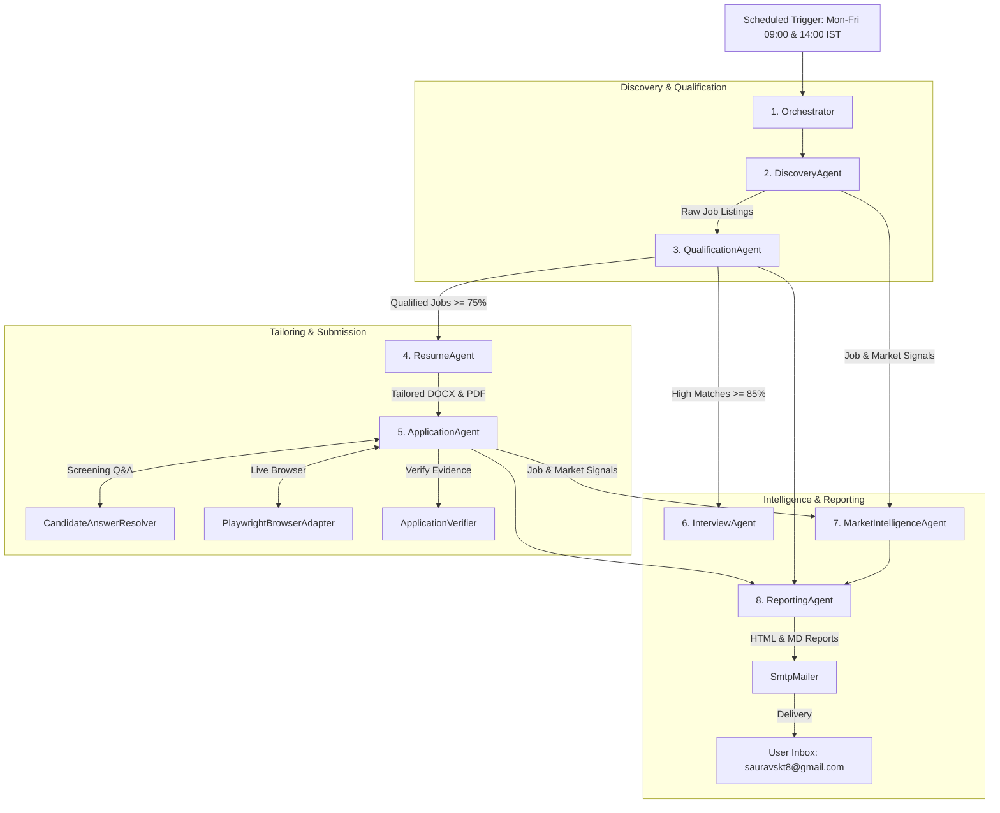

# Autonomous Career Agent Architecture

The system operates with **8 core agents** coordinated by an executive orchestrator, backed by **4 specialized execution engines**. 

Together, they form a closed-loop autonomous system that discovers opportunities across Pan India, qualifies them against verified candidate facts, generates ATS-tailored resumes, executes live applications on Naukri, builds technical interview packs, and delivers daily verified reports to your inbox.

---

### Agent Architecture Overview

> **Interactive View:** You can also open [agents_flowchart.html](file:///c:/Users/2016tu/Desktop/Projects/Naukri/agents_flowchart.html) directly in your browser.

<b>Click to expand Mermaid text diagram</b>

---

---

### Core Agent Roster

| # | Agent | Code Reference | Core Responsibility | Primary Output |
|---|---|---|---|---|
| 1 | **Orchestrator** | [`Orchestrator`](file:///c:/Users/2016tu/Desktop/Projects/Naukri/src/agents/orchestrator.py#L36) | Pipeline director & transaction coordinator | End-to-end run lifecycle & database synchronization |
| 2 | **Discovery Agent** | [`DiscoveryAgent`](file:///c:/Users/2016tu/Desktop/Projects/Naukri/src/agents/discovery.py#L23) | Multi-query job discovery & early salary filtering | Deduplicated `SALARY_ELIGIBLE` jobs |
| 3 | **Qualification Agent** | [`QualificationAgent`](file:///c:/Users/2016tu/Desktop/Projects/Naukri/src/agents/qualification.py#L23) | 5-dimensional match scoring & gap analysis | `JobScore` (0–100%) & `JobEvidence` |
| 4 | **Resume Agent** | [`ResumeAgent`](file:///c:/Users/2016tu/Desktop/Projects/Naukri/src/agents/resume_agent.py#L65) | Truthful ATS-optimized resume tailoring | Target-specific `.docx` & `.pdf` ATS resumes |
| 5 | **Application Agent** | [`ApplicationAgent`](file:///c:/Users/2016tu/Desktop/Projects/Naukri/src/agents/application.py#L29) | State-machine execution & live application submission | Verified `APPLIED_CONFIRMED` applications |
| 6 | **Interview Agent** | [`InterviewAgent`](file:///c:/Users/2016tu/Desktop/Projects/Naukri/src/agents/interview_agent.py#L21) | 3-tier technical interview preparation pack generation | 7-document interview suites per top match |
| 7 | **Market Intelligence Agent** | [`MarketIntelligenceAgent`](file:///c:/Users/2016tu/Desktop/Projects/Naukri/src/agents/market_intelligence.py#L34) | Macro-market skill velocity & compensation analytics | Trend tracking ($\uparrow, \downarrow, \rightarrow$) & career advice |
| 8 | **Reporting Agent** | [`ReportingAgent`](file:///c:/Users/2016tu/Desktop/Projects/Naukri/src/agents/reporting.py#L14) | Daily & weekly intelligence report generation | Daily & weekly responsive HTML & Markdown reports |

---

### Detailed Agent Roles & Internal Workings

#### 1. [Orchestrator](file:///c:/Users/2016tu/Desktop/Projects/Naukri/src/agents/orchestrator.py#L36) (Central Controller)
- **Role**: Master pipeline conductor that initiates, monitors, and synchronizes the workflow across all agents and database repositories.
- **How it works**:
  1. Bootstraps SQLite database sessions and loads [`config/config.yaml`](file:///c:/Users/2016tu/Desktop/Projects/Naukri/config/config.yaml) and candidate truth from [`candidate/candidate_facts.yaml`](file:///c:/Users/2016tu/Desktop/Projects/Naukri/candidate/candidate_facts.yaml).
  2. Spawns and chains the specialized agents in strict sequence.
  3. Enforces quota limits (e.g. max 35 applications/day) and state transitions.
  4. Manages the final hand-off to reporting and email dispatch.

#### 2. [DiscoveryAgent](file:///c:/Users/2016tu/Desktop/Projects/Naukri/src/agents/discovery.py#L23) (Market Explorer)
- **Role**: Scans Naukri for high-value architecture vacancies matching configured search queries without location throttling.
- **How it works**:
  1. **Pan India Search**: Queries Naukri directly (e.g., `oracle-cloud-infrastructure-architect-jobs`, `ai-architect-jobs`, `genai-architect-jobs`, `agentic-ai-architect-jobs`) across Pan India, Remote, and Hybrid.
  2. **Employer Safety Guardrail**: Instantly inspects the company name. Any occurrence matching Cognizant or CTS is immediately discarded.
  3. **Run & Database Deduplication**: Computes hash keys and checks `job_repo.exists()` to avoid redundant processing.
  4. **Early Salary Filter**: Invokes [`salary_parser.py`](file:///c:/Users/2016tu/Desktop/Projects/Naukri/src/naukri/salary_parser.py). Postings with a disclosed minimum below ₹25 LPA are marked `SALARY_REJECTED` and bypassed. Postings with $\ge$ 25 LPA or undisclosed compensation are marked `SALARY_ELIGIBLE`.
  5. Fetches full job specifications and persists them to the database.

#### 3. [QualificationAgent](file:///c:/Users/2016tu/Desktop/Projects/Naukri/src/agents/qualification.py#L23) (Fit & Evidence Evaluator)
- **Role**: Multi-dimensional evaluator that rigorously scores job descriptions against candidate facts without hallucination.
- **How it works**:
  1. **5-Dimensional Analysis**: Evaluates JD across:
     - *Cloud & OCI Architecture* (VCN, DRG, FastConnect, Autonomous DB, OKE)
     - *AI & Agentic Architectures* (LLMs, RAG, LangGraph, MCP, Multi-Agent, Prompt Ops)
     - *Kubernetes & Containers* (OKE, Helm, RBAC, StorageClass)
     - *Security & Identity* (OCI IAM, Zero Trust, SAML, PAM)
     - *IaC & Automation* (Terraform, Ansible, CI/CD)
  2. **Scoring Model**: Generates a normalized score (0–100%). Jobs scoring $\ge 75\%$ become `QUALIFIED`; jobs scoring $\ge 85\%$ are flagged as `HIGH_MATCH`.
  3. **Evidence Extraction**: Segregates observed JD requirements into:
     - *Verified strengths*: Direct matches with candidate facts.
     - *Adjacent capabilities*: Transferable skills (e.g. AWS/GCP to OCI).
     - *Hard barriers*: Prerequisites the candidate does not have.

#### 4. [ResumeAgent](file:///c:/Users/2016tu/Desktop/Projects/Naukri/src/agents/resume_agent.py#L65) (Truthful ATS Resume Engine)
- **Role**: Automatically formats customized, ATS-compliant resumes in `.docx` and `.pdf` formats.
- **How it works**:
  1. **Candidate Truth Invariant**: Uses master facts strictly from [`resumes/master/Saket_Saurav_OCI.docx`](file:///c:/Users/2016tu/Desktop/Projects/Naukri/resumes/master/Saket_Saurav_OCI.docx). Never fabricates skills, employers, or roles.
  2. **Keyword Optimization**: Emphasizes candidate's real experiences matching the JD's key terms (e.g. prioritizing OKE, IaC, or Agentic AI projects).
  3. **ATS Validation**: Enforces standard single-column layout, standard headers, and machine extractability.
  4. **Versioning**: Computes SHA-256 content hashes and registers version records in SQLite.

#### 5. [ApplicationAgent](file:///c:/Users/2016tu/Desktop/Projects/Naukri/src/agents/application.py#L29) (Live Submission & Lifecycle Engine)
- **Role**: Executes live application submissions on Naukri while maintaining safety barriers and transaction idempotency.
- **How it works**:
  1. **Idempotency Guard**: Verifies `has_been_applied` to eliminate any possibility of duplicate submissions.
  2. **Interactive Apply Handling**: Navigates to job URLs using authenticated Chrome sessions; clicks Apply, and handles chatbot dialogues or modal questionnaires.
  3. **Question Answering**: Coordinates with [`CandidateAnswerResolver`](file:///c:/Users/2016tu/Desktop/Projects/Naukri/src/naukri/candidate_answer_resolver.py#L25) to answer recruiter screening prompts (experience years, notice period, location preference, CTC).
  4. **Safety Boundaries**: Halts and registers `APPLICATION_BLOCKED` if encountering CAPTCHA, MFA, payment demands, or external off-platform redirects.
  5. **Verification**: Works with [`ApplicationVerifier`](file:///c:/Users/2016tu/Desktop/Projects/Naukri/src/naukri/verifier.py#L27) to confirm the green **"Applied"** badge on reload before setting status to `APPLIED_CONFIRMED`.

#### 6. [InterviewAgent](file:///c:/Users/2016tu/Desktop/Projects/Naukri/src/agents/interview_agent.py#L21) (Interview Simulator & Pack Builder)
- **Role**: Builds an end-to-end 7-file technical interview preparation package for high-match opportunities (`>= 85%`).
- **How it works**:
  - Generates a dedicated dossier in `interviews/{company}/{role}/` containing:
    1. `JD.md` — Full sanitized job specification.
    2. `match-analysis.md` — Dimensional breakdown and talking points.
    3. `company-brief.md` — Company background and tech stack profile.
    4. `round1-screening.md` — HR/Recruiter screening prep (notice period, CTC, location mobility).
    5. `round2-technical.md` — Level 1 Knowledge & Level 2 Architecture questions.
    6. `round3-system-design.md` — Level 3 Principal Architect system designs (multi-region DR, landing zones, private OKE).
    7. `questions-to-ask.md` — Targeted questions for the engineering leadership.

#### 7. [MarketIntelligenceAgent](file:///c:/Users/2016tu/Desktop/Projects/Naukri/src/agents/market_intelligence.py#L34) (Macro Trend Engine)
- **Role**: Tracks macro-level hiring trends, emerging architectural patterns, and compensation shifts.
- **How it works**:
  1. **Taxonomy Tracking**: Analyzes mentions of cloud platforms (OCI, AWS, Azure, GCP), tools (Terraform, Kubernetes, LangGraph, MCP), and architectures (Agentic AI, RAG, Zero Trust).
  2. **Velocity Metrics**: Classifies trends into $\uparrow$ Rising, $\downarrow$ Declining, $\rightarrow$ Steady, or NEW.
  3. **Strategic Recommendations**: Suggests high-yield search terms and adjacent skills worth acquiring based on current market demand.

#### 8. [ReportingAgent](file:///c:/Users/2016tu/Desktop/Projects/Naukri/src/agents/reporting.py#L14) (Intelligence Publisher)
- **Role**: Converts pipeline telemetry into clean executive summaries in Markdown and responsive HTML.
- **How it works**:
  1. **Strict Status Separation**: Classifies every processed listing into Confirmed, Unverified, Blocked, Failed, or Manual.
  2. **Click-to-Verify Links**: Embeds direct verification links (`https://www.naukri.com/job-listings-...`) so you can verify each application directly in your browser.
  3. **Dual Formats**: Emits `.md` and `.html` files in `reports/daily/` and `reports/weekly/`.
  4. Triggers [`SmtpMailer`](file:///c:/Users/2016tu/Desktop/Projects/Naukri/src/email_service/smtp_mailer.py#L15) to dispatch HTML reports to `sauravskt8@gmail.com`.

---

### Supporting Execution Engines

To support these 8 agents, the following subsystems handle browser mechanics, safety, and communication:

1. [PlaywrightBrowserAdapter](file:///c:/Users/2016tu/Desktop/Projects/Naukri/src/naukri/playwright_adapter.py#L42): Authenticated Chrome automation engine that injects your session cookies (`artifacts/naukri_auth.json`), handles DOM navigation, interacts with recruiter chatbots, and captures screenshot proofs.
2. [CandidateAnswerResolver](file:///c:/Users/2016tu/Desktop/Projects/Naukri/src/naukri/candidate_answer_resolver.py#L25): Dynamic form-field resolver that answers recruiter screening questions strictly from verified candidate facts (e.g. 6.5 yrs cloud, 2 yrs AI, 90-day notice period, Pan India mobility) with zero hallucination.
3. [ApplicationVerifier](file:///c:/Users/2016tu/Desktop/Projects/Naukri/src/naukri/verifier.py#L27): 5-level hierarchical auditor ensuring applications are confirmed (e.g. checking the `.already-applied` green pill badge and cross-verifying the Naukri Application History counter).
4. [SmtpMailer](file:///c:/Users/2016tu/Desktop/Projects/Naukri/src/email_service/smtp_mailer.py#L15): Secure SMTP email dispatcher with retry logic and TLS support, configured to deliver daily reports to `sauravskt8@gmail.com`.