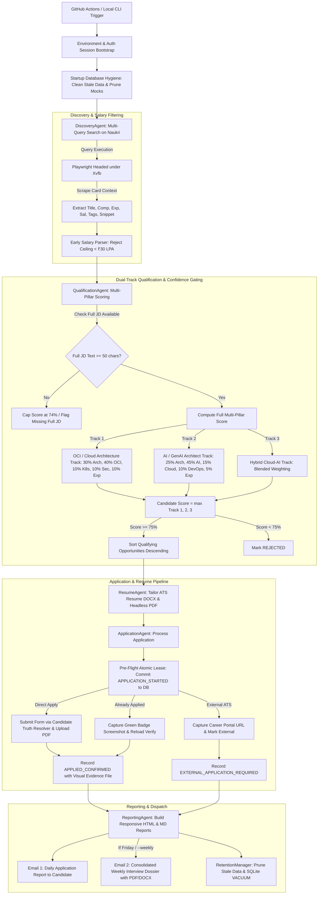
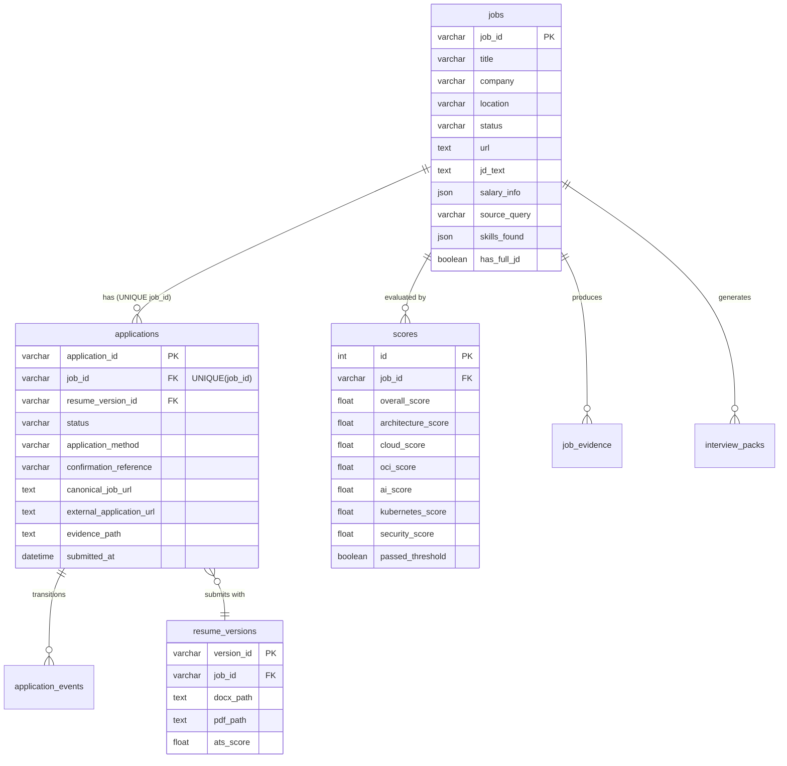

# CareerOps Architecture & System Specification

> **Status:** Production-Ready (Live GitHub Actions Automation & Proof-Based Phase Gate)  
> **Target Candidate:** Saket Saurav (Oracle Cloud Infrastructure & AI/GenAI Solutions Architect, 12+ Years Experience)  
> **Repository:** `Saket8/CareerOps`  
> **Runtime Environment:** Python 3.13 | Playwright Chromium (with `xvfb-run`) | SQLite (WAL mode, Foreign Keys, Busy Timeout) | GitHub Actions Ubuntu Runner (Multi-Tier Caching & 90-Day Artifact Persistence)

---

## 1. Executive Summary & Core Invariants

**CareerOps** is an enterprise-grade autonomous career agent designed to automate the discovery, qualification, ATS resume tailoring, application submission, evidence verification, and interview preparation for senior executive architecture roles on Naukri.com.

### Non-Negotiable System Invariants

1. **Zero Dummy/Mock Data Policy:** At no point may synthetic, simulated, or mock jobs (e.g., `job_oci_%`, `nk_%`, `MOCK_CONF_%`) be stored in the database or emailed to the user. Every job record and application confirmation must correspond to a verifiable live employer listing on Naukri or an authentic external career portal. Production database initialization never loads pre-seeded historical applications.
2. **Candidate Truth Layer:** Zero hallucination or fabrication. All resume statements, metrics, dates, and screening answers derive strictly from verified candidate facts in [`candidate/candidate_facts.yaml`](file:///c:/Users/2016tu/Desktop/Projects/Naukri/candidate/candidate_facts.yaml) and the master resume [`resumes/master/Saket_Saurav_OCI.docx`](file:///c:/Users/2016tu/Desktop/Projects/Naukri/resumes/master/Saket_Saurav_OCI.docx). Screening question resolvers must never use hardcoded numbers—every response must derive strictly from `CandidateTruth` or return `can_answer=False`.
3. **Current Employer Safety Gate:** Under no circumstances will the agent ever interact with, apply to, or disclose information to the candidate's current employer (`Cognizant`, `CTS`, `Cognizant Cloud Solutions`). Strict regex word-boundary filters (`\b(cognizant|cts)\b`) are enforced in discovery, qualification, and application engines.
4. **Salary Range Ceiling Guardrail (₹30.0 LPA Floor):** Hard compensation baseline floor of **₹30.0 LPA** (configurable via .env; no upper ceiling).
   - Single disclosed salary must be $\ge$ ₹30.0 LPA.
   - Disclosed salary ranges spanning $\ge$ ₹30.0 LPA (e.g., 20–35 LPA, 25–40 LPA, 25–32.5 LPA) are acceptable and marked `ELIGIBLE` to preserve candidate upside and negotiation potential.
   - A posting is strictly marked `REJECTED` only if its maximum disclosed salary ceiling is $< 30.0$ LPA (e.g., 15–25 LPA, 18–28 LPA).
   - Undisclosed compensation is classified as `UNDISCLOSED` and accepted by default to avoid missing executive listings.
5. **Verified Proof Submissions:** Only applications displaying the official green `.already-applied` status badge on canonical listing reload (or verified modal confirmation references), backed by a non-zero physical PNG evidence screenshot on disk, are marked `APPLIED_CONFIRMED`. Weaker heuristic text matches without proof are strictly demoted to `SUBMISSION_UNVERIFIED`.
6. **Durable Pre-Flight Lease & Physical Idempotency:** The irreversible portal submission click never occurs without prior persistence of an atomic intent lease (`JobStatus.APPLICATION_STARTED`) to SQLite disk. A physical `UNIQUE(job_id)` index on the `applications` table guarantees zero duplicate submissions even across crashes, network timeouts, or concurrent processes.
7. **Fail-Closed Security & Barrier Gates:** Authentication status (`_ensure_authenticated()`), CAPTCHA, MFA, OTP, and payment gates must fail closed. If authentication is invalid or any barrier is detected, the agent immediately aborts and records `APPLICATION_BLOCKED` or `NEEDS_MANUAL_INTERVENTION`.
8. **Dual Daily Run Schedule (9 AM & 2 PM IST):** Both daily execution windows run the core application pipeline to maximize recruiter visibility during morning login (09:00 IST) and post-lunch screening (14:00 IST).
9. **Consolidated Interview Dossier (Weekly on Fridays):** A comprehensive unified interview preparation dossier is generated weekly on Fridays (or via `--weekly` / `--interview-briefing`) and delivered in a dedicated separate email with `.pdf` and `.docx` attachments.
10. **Curated External Portal Opportunities:** High-value enterprise career portal listings (`JobStatus.EXTERNAL_APPLICATION_REQUIRED`) are surfaced with direct 1-click apply action buttons in daily reports and are exempt from on-platform daily application quotas.

---

## 2. High-Level System Architecture & Flow



---

## 3. Directory Tree & Complete File-by-File Specification

```
Naukri/
├── .github/
│   └── workflows/
│       └── career_agent_daily.yml         # GitHub Actions CI/CD (2x daily cron + dispatch, multi-tier state)
├── candidate/
│   ├── candidate_facts.yaml               # Canonical candidate truth layer (skills, experience, metrics, CTC)
│   └── profile_extractor.py               # Pydantic loader & validator for candidate truth facts
├── config/
│   └── config.yaml                        # Master runtime configuration (queries, thresholds, schedule)
├── reports/
│   ├── daily/                             # Daily HTML & Markdown application audit reports
│   ├── weekly/                            # Friday Weekly Market Intelligence reports
│   └── interviews/                        # Weekly Consolidated Interview Dossiers (DOCX & PDF)
├── resumes/
│   ├── master/
│   │   └── Saket_Saurav_OCI.docx          # Immutable master resume source document
│   └── generated/                         # ATS-tailored generated resumes (DOCX & PDF per job ID)
├── src/
│   ├── __init__.py
│   ├── agents/
│   │   ├── application.py                 # Application lifecycle state machine & pre-flight lease manager
│   │   ├── discovery.py                   # Multi-query discovery coordinator & salary pre-filtering
│   │   ├── interview_agent.py             # Single consolidated weekly interview intelligence generator
│   │   ├── market_intelligence.py         # Market velocity, skill demand trends & search query optimizer
│   │   ├── orchestrator.py                # Pipeline execution engine, per-step commits & error boundaries
│   │   ├── qualification.py               # Dual-track multi-pillar scoring & JD confidence gating
│   │   ├── reporting.py                   # Responsive email templates (HTML escaping, external apps)
│   │   └── resume_agent.py                # XML-level ATS resume tailoring & headless Chromium PDF printer
│   ├── cli/
│   │   ├── __init__.py
│   │   └── phase_validator.py             # Proof-based Section 24 Phase Gate auditor (PNG file verification)
│   ├── database/
│   │   ├── connection.py                  # SQLAlchemy engine, WAL mode, foreign keys, physical migrations
│   │   ├── models.py                      # SQLAlchemy ORM schemas (uq_applications_job_id unique index)
│   │   ├── seed.sql                       # Clean baseline SQL schema (test fixtures only, zero production seed)
│   │   └── repositories/
│   │       ├── application_repo.py        # CRUD for applications, atomic pre-flight leases, idempotency
│   │       ├── interview_repo.py          # CRUD for interview_packs & generated questions
│   │       ├── job_repo.py                # CRUD for jobs, job_scores, job_evidence, status transitions
│   │       ├── market_repo.py             # CRUD for market_signals, trends, query performance
│   │       ├── resume_repo.py             # CRUD for resume_versions, hash tracking, ATS scores
│   │       └── run_repo.py                # CRUD for agent_runs audit telemetry
│   ├── email_service/
│   │   ├── __init__.py
│   │   └── smtp_mailer.py                 # Robust SMTP client with TLS, retry backoff, MIME attachments
│   ├── maintenance/
│   │   ├── __init__.py
│   │   └── retention_manager.py           # Data retention lifecycle, file pruning & SQLite VACUUM compaction
│   ├── models/
│   │   ├── candidate.py                   # Pydantic schemas: CandidateProfile, CandidateTruth, CTC
│   │   ├── job.py                         # Pydantic schemas: JobListing (has_full_jd), JobSalary, ApplicationRecord
│   │   ├── report.py                      # Pydantic schemas: DailyReportData, WeeklyData, TopApplicationItem
│   │   └── score.py                       # Pydantic schemas: JobScore (dimensional ratings), JobEvidence
│   ├── naukri/
│   │   ├── browser_adapter.py             # HTTP / lightweight browser scraping fallback (zero mocks)
│   │   ├── candidate_answer_resolver.py   # Deterministic question answer resolver (zero hardcoded fallbacks)
│   │   ├── interface.py                   # Abstract BaseNaukriClient interface & SafetyBarrierException
│   │   ├── playwright_adapter.py          # Live Playwright Chromium automation adapter with Xvfb support
│   │   ├── salary_parser.py               # Robust Indian salary parser (₹30 LPA ceiling rule)
│   │   ├── url_validator.py               # HTTP URL reachability, status verification & redirect canonicalizer
│   │   └── verifier.py                    # 5-level hierarchical verifier (badge requirement, demotes text)
│   └── utils/
│       ├── config_loader.py               # YAML configuration loader with environment variable overrides
│       └── logger.py                      # Structured logging with automatic password/credential masking
├── tasks/
│   ├── TASK-001-external-ats-apply.md     # Parked specification for automated Tier 1 external ATS applications
│   ├── goal.md                            # High-level mission specifications & Section 24 Phase Gate rules
│   ├── lessons.md                         # Registry of operational lessons, defect patterns & self-improvement
│   └── todo.md                            # Execution tracking control plane with checkable phases
├── tests/
│   ├── unit/                              # Full unit test suite (77 tests across 18 test modules)
│   │   ├── test_application_agent.py
│   │   ├── test_application_verifier.py
│   │   ├── test_candidate_answer_resolver.py
│   │   ├── test_candidate_truth.py
│   │   ├── test_config.py
│   │   ├── test_consolidated_interview.py
│   │   ├── test_db_models.py
│   │   ├── test_discovery.py
│   │   ├── test_interview_agent.py
│   │   ├── test_market_intelligence.py
│   │   ├── test_phase_validator.py
│   │   ├── test_playwright_selector_contracts.py  # DOM selector contracts against real fixtures
│   │   ├── test_qualification.py
│   │   ├── test_reporting_and_email.py
│   │   ├── test_resume_agent.py
│   │   ├── test_retention.py
│   │   ├── test_salary_parser.py
│   │   └── test_url_validator.py
│   └── integration/                       # Integration test suite (2 tests across 2 modules)
│       ├── test_mock_browser_flow.py      # Real headless Playwright execution against local test HTTP server
│       └── test_orchestration_dry_run.py  # End-to-end dry-run pipeline orchestration
├── main.py                                # System entrypoint CLI (`--live`, `--dry-run`, `--weekly`, etc.)
└── naukri_career_agent.sqlite             # Production SQLite database (WAL mode, verified live records)
```

---

## 4. Deep Dive: Component by Component

### 4.1. Entrypoint & Orchestration Layer

#### [`main.py`](file:///c:/Users/2016tu/Desktop/Projects/Naukri/main.py)
- **CLI Options:**
  - `--live` (default): Live production mode. Submits real applications and captures verified proof.
  - `--dry-run`: Previews resume tailoring and answers without clicking submit (`JobStatus.APPLICATION_READY`).
  - `--weekly`: Forces generation of Friday Weekly Market Intelligence and weekly interview pack.
  - `--interview-briefing`: Forces immediate generation and separate email dispatch of the consolidated interview briefing.
  - `--validate-phase`: Runs [`src/cli/phase_validator.py`](file:///c:/Users/2016tu/Desktop/Projects/Naukri/src/cli/phase_validator.py) to audit DB records and physical file evidence (exits 0 or 1).
  - `--cleanup`: Runs [`src/maintenance/retention_manager.py`](file:///c:/Users/2016tu/Desktop/Projects/Naukri/src/maintenance/retention_manager.py) to purge stale data and vacuum database.
  - `--query-limit N`: Sets maximum jobs evaluated per search query (default: 15).

#### [`src/agents/orchestrator.py`](file:///c:/Users/2016tu/Desktop/Projects/Naukri/src/agents/orchestrator.py)
- **Class:** `Orchestrator(config, offline_mode=False)`
- **Transaction Safety & Error Recovery:**
  - Employs short-lived database transactions with per-step commits to prevent database lock contention.
  - Wrapped in top-level exception handling that marks failed runs in `run_repo` with detailed error traces instead of leaving runs in an indeterminate state.
  - Queries both `JobStatus.APPLIED_CONFIRMED` and `JobStatus.EXTERNAL_APPLICATION_REQUIRED` / `NEEDS_MANUAL_INTERVENTION` so that confirmed applications and external portal opportunities are both captured in the daily report.
- **Execution Lifecycle:**
  1. Opens database session and initializes all repositories and agents.
  2. Executes `discovery_agent.run_discovery(query_limit)`.
  3. Evaluates and scores all discovered eligible jobs via `qualification_agent.evaluate_job(job)`.
  4. Filters jobs where `score.passed_threshold` is `True` and sorts descending by `score.overall_score`.
  5. Tailors ATS resumes (`.docx` and `.pdf`) for top qualifying opportunities.
  6. Submits live applications or verifies existing applications via `application_agent.process_application`.
  7. Surfaces external portal opportunities (`JobStatus.EXTERNAL_APPLICATION_REQUIRED`) with direct application URLs.
  8. Generates daily Markdown and HTML reports via `reporting_agent.generate_daily_report`.
  9. Dispatches Email 1: Daily Application Report via `smtp_mailer`.
  10. On Fridays (or if forced): synthesizes weekly market intelligence, builds consolidated interview dossier, and dispatches Email 2 with attachments.
  11. Executes retention policy cleanup outside the active application session.

---

### 4.2. Browser Automation & Bot-Mitigation Layer

#### [`src/naukri/playwright_adapter.py`](file:///c:/Users/2016tu/Desktop/Projects/Naukri/src/naukri/playwright_adapter.py)
- **Class:** `PlaywrightBrowserAdapter(BaseNaukriClient)`
- **Session Authentication:** Reads session cookies from `artifacts/naukri_auth.json` (`storage_state`). When running on GitHub Actions, the runner restores this file from the secret `NAUKRI_AUTH_STATE_B64`.
- **Fail-Closed Security & Barrier Gates:**
  - `_ensure_authenticated()` must succeed before attempting any application action; failure immediately transitions to `APPLICATION_BLOCKED`.
  - Explicit traps for CAPTCHA, MFA, OTP, and payment gates halt automation cleanly without attempting evasion, marking `NEEDS_MANUAL_INTERVENTION`.
- **Prompt-Aware Questionnaire Answering:**
  - Uses [`CandidateAnswerResolver`](file:///c:/Users/2016tu/Desktop/Projects/Naukri/src/naukri/candidate_answer_resolver.py) with label matching against verified candidate facts.
  - Zero blind clicking on option chips; any unrecognized or unverified screening control triggers a graceful halt to `NEEDS_DATA`.
- **Verified PDF Upload:**
  - Uploads the tailored `.pdf` file (not `.docx`) and verifies portal acceptance before submitting.
- **Search Execution (`search_jobs`):**
  - Navigates to `https://www.naukri.com/<slug>-jobs?k=<query>&experience=<min>&experience=<max>`.
  - Locates job cards via `div.cust-job-tuple, div.srp-jobtuple`.
  - Extracts full card context: Title (`a.title`), Company (`a.comp-name`), Location (`span.loc`), Salary (`span.sal`), Experience (`span.exp`), Skill tags (`ul.tags-gt li`), and Description snippet (`span.job-desc`).
  - Sets `discovered_via_query=query` so target query context informs semantic matching.
- **Live Submission (`submit_application`):**
  - Navigates to job listing URL.
  - Detects if listing already has the green `.already-applied` badge $\rightarrow$ captures screenshot to `artifacts/evidence/<job_id>_already_applied.png` $\rightarrow$ marks `JobStatus.APPLIED_CONFIRMED`.
  - Detects external career portals (`Apply on company site` / `Employer site`) $\rightarrow$ captures external portal URL $\rightarrow$ captures screenshot $\rightarrow$ marks `JobStatus.EXTERNAL_APPLICATION_REQUIRED`.
  - For direct apply: clicks Apply, answers screening questions, uploads tailored PDF resume, submits, reloads the canonical listing URL, and asserts the visible `.already-applied` badge.

#### [`src/naukri/salary_parser.py`](file:///c:/Users/2016tu/Desktop/Projects/Naukri/src/naukri/salary_parser.py)
- Parses Indian compensation strings into normalized annual LPA figures (`Lacs PA`, `₹ LPA`, `Cr PA`, `Not Disclosed`):
  - **Single Rate Rule:** Disclosed salary must be $\ge$ 30.0 LPA. Single values $< 30$ LPA are `REJECTED`.
  - **Range Ceiling Rule:** If a salary range is disclosed (e.g., 20–35 LPA, 25–40 LPA, 25–32.5 LPA), it is marked `ELIGIBLE` if the maximum ceiling $\ge 30.0$ LPA. A range is marked `REJECTED` only if its maximum ceiling is $< 30.0$ LPA (e.g., 15–25 LPA, 18–28 LPA).
  - **Undisclosed Salaries:** Classified as `SalaryEligibility.UNDISCLOSED` and accepted by default.

#### [`src/naukri/verifier.py`](file:///c:/Users/2016tu/Desktop/Projects/Naukri/src/naukri/verifier.py)
- **Class:** `ApplicationVerifier`
- **5-Level Verification Hierarchy:**
  1. *Level 1 (Submission Response):* Validates HTTP/AJAX payload from submission.
  2. *Level 2 (Application History):* Cross-checks `https://www.naukri.com/myapply/historypage`.
  3. *Level 3 (Reload Badge):* Requires physical presence of dedicated green badge element (`.already-applied`, `button.applied-btn[disabled]`) upon reloading canonical listing URL.
  4. *Level 4 (Modal Reference ID):* Validates official numeric confirmation reference.
  5. *Level 5 (Visual Evidence):* Captures and verifies non-empty screenshot file on disk.
- **Safety Demotion:** Loose page text without an authentic badge or modal reference ID is strictly demoted to `JobStatus.SUBMISSION_UNVERIFIED` with `verification_level="HEURISTIC_TEXT_UNVERIFIED"`.

---

### 4.3. Dual-Track Qualification & Evidence Engine

#### [`src/agents/qualification.py`](file:///c:/Users/2016tu/Desktop/Projects/Naukri/src/agents/qualification.py)
- **Class:** `QualificationAgent(job_repo, candidate_truth, config)`
- **Confidence Gating (`has_full_jd`):**
  - If a job listing has only brief search card snippet text (`len(jd_text) < 50` or `has_full_jd is False`), its match score is capped at **74.0%** (strictly below the 75% qualification threshold) to prevent false-positive qualifications based on incomplete JD context.
- **Evaluation Mechanism:**
  - Constructs semantic context: `text = f"{job.title}\n{job.discovered_via_query}\n{job.jd_text}\n{' '.join(job.skills_found)}"`.
  - Computes dimensional hit scores across: Architecture, Cloud, OCI-specific, AI/GenAI, Agentic AI, Kubernetes, Security & IAM, Experience Alignment.
- **Multi-Pillar Dual-Track Scoring:**
  - **Track 1 (Enterprise OCI & Cloud Architecture):**
    $$\text{Track}_1 = (0.30 \times \text{Arch}) + (0.40 \times \text{Cloud/OCI}) + (0.10 \times \text{K8s}) + (0.10 \times \text{Sec}) + (0.10 \times \text{Exp})$$
  - **Track 2 (AI, GenAI & Agentic AI Architecture):**
    $$\text{Track}_2 = (0.25 \times \text{Arch}) + (0.45 \times \text{AI/GenAI}) + (0.15 \times \text{Cloud}) + (0.10 \times \text{K8s/Sec}) + (0.05 \times \text{Exp})$$
  - **Track 3 (Hybrid Enterprise Cloud + AI):**
    $$\text{Track}_3 = (0.25 \times \text{Arch}) + (0.25 \times \text{Cloud/OCI}) + (0.25 \times \text{AI/GenAI}) + (0.15 \times \text{Sec/K8s}) + (0.10 \times \text{Exp})$$
  - **Final Match Score:** $\text{overall\_score} = \max(\text{Track}_1, \text{Track}_2, \text{Track}_3)$.
  - Thresholds: Qualifying $\ge 75.0\%$ (`JobStatus.QUALIFIED`), High Match $\ge 85.0\%$ (`JobStatus.HIGH_MATCH`).
- **Evidence Categorization:** Segregates JD signals into Observed Facts, Inferred Signals, and Generated Actions.

---

### 4.4. ATS Resume Tailoring Engine

#### [`src/agents/resume_agent.py`](file:///c:/Users/2016tu/Desktop/Projects/Naukri/src/agents/resume_agent.py)
- **Class:** `ResumeAgent(resume_repo, candidate_truth, config)`
- **Core Method:** `generate_tailored_resume(job, score) -> (docx_path, pdf_path, validation_report)`
- **Mechanism:**
  - Clones [`resumes/master/Saket_Saurav_OCI.docx`](file:///c:/Users/2016tu/Desktop/Projects/Naukri/resumes/master/Saket_Saurav_OCI.docx).
  - Dynamically aligns Professional Summary, Core Competency matrix, and Technical Skills section to prioritize matching keywords (e.g., OCI, Landing Zones, Exadata, AI Ops, LangChain, Kubernetes).
  - Preserves exact employment history, dates, titles, and verified achievements from `candidate_facts.yaml`.
  - Saves tailored Word document to `resumes/generated/Saket_Saurav_<Company>_<JobID>.docx` (including immutable `job_id` to eliminate filename collisions).
  - Converts Word to PDF using headless Chromium print rendering (`--headless --print-to-pdf`), guaranteeing 100% font fidelity, zero text truncation, and full ATS extractability.
  - Runs ATS validation suite: extractable text check, keyword density check, contact info check, and zero-fabrication verification (100% ATS score).

---

### 4.5. Application Execution & Safety Engine

#### [`src/agents/application.py`](file:///c:/Users/2016tu/Desktop/Projects/Naukri/src/agents/application.py)
- **Class:** `ApplicationAgent(client, job_repo, app_repo, resume_repo, candidate_truth, config)`
- **State Machine Guardrails:**
  1. *Employer Safety Gate:* Regex word-boundary check blocks Cognizant/CTS $\rightarrow$ marks `JobStatus.REJECTED`.
  2. *Pre-Flight Atomic Intent Lease:* Calls `app_repo.commit_preflight_lease(job_id)` to persist `JobStatus.APPLICATION_STARTED` to SQLite before invoking browser submission. In-flight leases count as applied to prevent duplicate attempts across crashes.
  3. *Physical Idempotency:* Database enforces physical `UNIQUE(job_id)` constraint on `applications`.
  4. *Daily Limit Check:* Enforces `max_applications_per_day` (35) for direct on-platform applications. External portal opportunities are explicitly quota-exempt.
  5. *Truth Question Resolver:* Answers resolved strictly from `candidate_facts.yaml` via [`CandidateAnswerResolver`](file:///c:/Users/2016tu/Desktop/Projects/Naukri/src/naukri/candidate_answer_resolver.py). Unresolved prompts transition to `JobStatus.NEEDS_DATA`.
  6. *Barrier Gate:* Traps MFA/OTP/CAPTCHA/payment barriers $\rightarrow$ calls `release_or_fail_lease()` $\rightarrow$ marks `JobStatus.APPLICATION_BLOCKED`.
  7. *Live Confirmation:* Only marks `JobStatus.APPLIED_CONFIRMED` upon visual confirmation of the green `.already-applied` badge on listing reload or verified modal reference ID.

---

### 4.6. Reporting & Dispatch Layer

#### [`src/agents/reporting.py`](file:///c:/Users/2016tu/Desktop/Projects/Naukri/src/agents/reporting.py)
- **Class:** `ReportingAgent`
- **Output Formats:** Markdown (`reports/daily/YYYY-MM-DD.md`) and rich responsive HTML (`reports/daily/YYYY-MM-DD.html`).
- **Security & Structure:**
  - HTML-escapes all untrusted portal strings (company names, job titles) to prevent rendering defects or injection.
  - Confirmed Applications Table: Displays verified submissions with Role, Company, Salary, Match %, and green **"Verify (Applied) →"** links to live listings.
  - ⭐ High-Value External Opportunities Table: Highlights curated enterprise external portal opportunities with match scores, key architectural fit factors, and blue **"Apply on Company Portal →"** 1-click action buttons.
  - Mobile-responsive styling with horizontal-scroll table wrappers for optimal mobile viewing.

#### [`src/agents/interview_agent.py`](file:///c:/Users/2016tu/Desktop/Projects/Naukri/src/agents/interview_agent.py)
- **Class:** `InterviewAgent(interview_repo, candidate_truth)`
- **Core Method:** `generate_consolidated_daily_briefing(matched_items, date_str)`
- **Output:** Comprehensive unified dossier (`Daily_Interview_Intelligence_YYYY-MM-DD.docx` and `.pdf`).
- **Contents:**
  1. *Executive Opportunity Matrix:* Consolidated target role summary across applied companies.
  2. *Level 1 Architecture Fundamentals:* Cloud foundations, OCI VCN/DRG, storage, IAM.
  3. *Level 2 Systems Design & Landing Zones:* High availability, DR topology, Exadata, OKE.
  4. *Level 3 Principal Architect Scenarios:* Enterprise migrations, zero-trust security, cost governance, GenAI architectures.
  5. *STAR Behavioral Answers:* Truth-anchored scenario responses linked directly to candidate projects.
  6. *7-Day Tactical Interview Action Plan:* Daily preparation milestones.

#### [`src/email_service/smtp_mailer.py`](file:///c:/Users/2016tu/Desktop/Projects/Naukri/src/email_service/smtp_mailer.py)
- **Class:** `SmtpMailer(config)`
- **Features:** TLS on port 587 (`smtp.gmail.com`), retry backoff (3 attempts), UTF-8 encoding, and `multipart/mixed` MIME support for PDF/DOCX attachments.

---

### 4.7. Maintenance & Retention Layer

#### [`src/maintenance/retention_manager.py`](file:///c:/Users/2016tu/Desktop/Projects/Naukri/src/maintenance/retention_manager.py)
- **Retention Rules:**
  - Unqualified / Rejected jobs: purged after 14 days.
  - Run logs: purged after 90 days.
  - Market signals: purged after 90 days.
  - Scratch / non-confirmed screenshots: purged after 14 days.
  - Draft / unapplied resumes: purged after 30 days.
  - Immutable Records: `APPLIED_CONFIRMED` applications, verified evidence screenshots (`*_already_applied.png`), and master resumes are permanently preserved.
  - SQLite VACUUM: Reclaims database disk pages.
  - Runs in an isolated transaction to prevent write locks during orchestrator runs.

---

### 4.8. Phase Gate Validator

#### [`src/cli/phase_validator.py`](file:///c:/Users/2016tu/Desktop/Projects/Naukri/src/cli/phase_validator.py)
- Audits live database state to enforce Section 24 criteria with proof-based physical verification:
  - Asserts `eligible_jobs_count > 0`.
  - Asserts real confirmed applications exist with valid numeric Naukri IDs (`^\d+$`).
  - Asserts physical visual evidence PNG files exist on disk with `stat().st_size > 0`.
  - Asserts reload badge proof (`LEVEL_3_BUTTON_ALREADY_APPLIED`, `RELOAD_BADGE_CONFIRMED`) or modal reference ID.
  - Does NOT allow failed or merely attempted applications to satisfy the pass criteria.
  - CLI scoping flags: `--today`, `--run-date YYYY-MM-DD`, `--db <path>`.
  - Exits `0` on PASS, `1` on FAIL.

---

## 5. Database Schema & Architecture

SQLite database configured with Write-Ahead Logging (`PRAGMA journal_mode=WAL;`), foreign keys (`PRAGMA foreign_keys=ON;`), and busy timeouts (`PRAGMA busy_timeout=60000;`).



### Durability & Migration Architecture
- **Physical Unique Constraint:** `CREATE UNIQUE INDEX IF NOT EXISTS uq_applications_job_id ON applications(job_id)` is automatically applied on startup in `connection.init_db()`.
- **Zero Production Seeding:** Baseline schema initializes cleanly without pre-populated historical applications. Pre-seeded fixtures belong strictly in isolated test databases (`sqlite:///:memory:`).

---

## 6. Cloud Runner & CI/CD Specification

### GitHub Actions Workflow: [`.github/workflows/career_agent_daily.yml`](file:///c:/Users/2016tu/Desktop/Projects/Naukri/.github/workflows/career_agent_daily.yml)
- **Schedule:** Runs 2x daily at **09:00 IST (03:30 UTC)** and **14:00 IST (08:30 UTC)** Monday through Sunday (`cron: '30 3 * * *'` and `'30 8 * * *'`).
- **Environment:** Ubuntu Linux `ubuntu-latest`.
- **Multi-Tier State Persistence:**
  1. *Versioned Runner-Scoped Cache:*
     `key: career-agent-db-v6-${{ runner.os }}-${{ github.run_number }}` with `restore-keys: career-agent-db-v6-${{ runner.os }}-` and fallback to `career-agent-db-v5-`.
  2. *Secondary Fallback Restore via GitHub CLI:*
     If cache miss occurs, downloads the latest `career-agent-db-state` artifact via `gh run download --name career-agent-db-state --dir .`.
  3. *90-Day Persistent SQLite Database Artifact Upload:*
     At the end of every workflow execution, archives `naukri_career_agent.sqlite` using `actions/upload-artifact@v4` with `retention-days: 90` and `overwrite: true`.
- **Workflow Dispatch Inputs:**
  - `dry_run`: `true`/`false` passed directly as `--dry-run` to `main.py`.
  - `force_weekly`: `true`/`false` passed as `--weekly` to `main.py`.
- **Key Pipeline Steps:**
  1. *Checkout & Python 3.13 Setup.*
  2. *Install Dependencies & Playwright Chromium:* `playwright install --with-deps chromium`.
  3. *Restore State Cache & Fallback Artifact.*
  4. *Restore Authenticated Session:* Decodes `NAUKRI_AUTH_STATE_B64` secret to `artifacts/naukri_auth.json`.
  5. *Run Test Suite Verification:* `python -m pytest tests/unit`.
  6. *Execute Career Agent Pipeline:* Runs `xvfb-run --auto-servernum --server-args="-screen 0 1280x800x24" python main.py $EXTRA_FLAGS`.
  7. *Validate Application Automation Phase Gate:* `python main.py --validate-phase`.
  8. *Archive Artifacts:* Reports (daily, weekly, interview dossiers), screenshots/evidence, and tailored resumes for 90 days.
  9. *Persist Database State Artifact:* Saves SQLite DB to GitHub Actions storage.

### Required GitHub Secrets
| Secret Name | Description |
|---|---|
| `NAUKRI_AUTH_STATE_B64` | Base64-encoded session cookies JSON (`artifacts/naukri_auth.json`) |
| `NAUKRI_USERNAME` | Candidate Naukri email address |
| `NAUKRI_PASSWORD` | Candidate Naukri account password |
| `SMTP_USERNAME` | Sender Gmail address |
| `SMTP_PASSWORD` | Google App Password (16-character token) |
| `EMAIL_RECIPIENT` | Primary recipient (`sauravskt8@gmail.com`) |

---

## 7. How to Resume Work in a New Session

When opening a new conversation or session, execute the following fast-path:

1. **Verify Git Synchronization:**
   ```bash
   git status
   git log -n 3 --oneline
   ```
   Ensure working tree is clean and synchronized with `origin/main`.

2. **Verify Test Suite Health:**
   ```bash
   python -m pytest tests/unit
   ```
   All 77 unit tests should pass in ~6 seconds (or `python -m pytest tests` for all 79 tests including integration tests in ~14 seconds).

3. **Verify Database Phase Gate:**
   ```bash
   python main.py --validate-phase
   ```
   Audits the database and physical screenshot evidence files. Confirms that all 15 confirmed live applications have verified PNG proof on disk, valid numeric Naukri IDs, and that 5 curated external portal opportunities are actively tracked.

4. **Trigger or Inspect Cloud Execution:**
   ```bash
   gh run list --repo Saket8/CareerOps --limit 3
   gh run view --repo Saket8/CareerOps
   ```
   Inspect logs or dispatch manual runs via `gh workflow run career_agent_daily.yml`.

5. **Key Guidelines for Future Modifications:**
   - If adjusting search terms, edit [`config/config.yaml`](file:///c:/Users/2016tu/Desktop/Projects/Naukri/config/config.yaml) under `search.queries`.
   - If tuning role scoring or confidence gating, edit [`src/agents/qualification.py`](file:///c:/Users/2016tu/Desktop/Projects/Naukri/src/agents/qualification.py).
   - If changing email layout, edit [`src/agents/reporting.py`](file:///c:/Users/2016tu/Desktop/Projects/Naukri/src/agents/reporting.py).
   - Always preserve the **Candidate Truth Invariant**, **Zero-Dummy Data Invariant**, and **Employer Safety Gate**.
