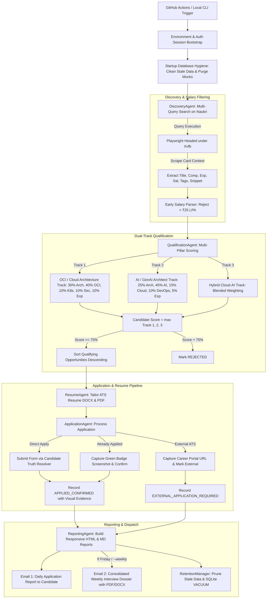
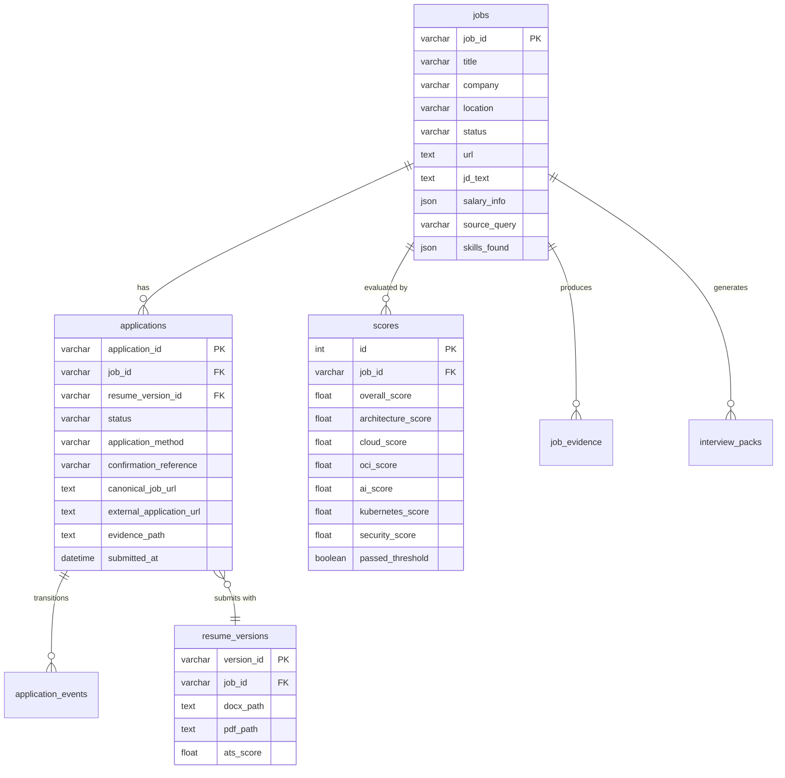

# CareerOps Architecture & System Specification

> **Status:** Production-Ready (Live GitHub Actions Automation)  
> **Target Candidate:** Saket Saurav (Oracle Cloud Infrastructure & AI/GenAI Solutions Architect, 12+ Years Experience)  
> **Repository:** `Saket8/CareerOps`  
> **Runtime Environment:** Python 3.13 | Playwright Chromium | SQLite (WAL mode) | GitHub Actions Ubuntu Runner (with `xvfb-run`)

---

## 1. Executive Summary & Core Invariants

**CareerOps** is an enterprise-grade autonomous career agent designed to automate the discovery, qualification, ATS resume tailoring, application submission, evidence verification, and interview preparation for senior executive architecture roles on Naukri.com.

### Non-Negotiable System Invariants
1. **Zero Dummy/Mock Data Policy:** At no point may synthetic, simulated, or mock jobs (e.g., `job_oci_%`, `nk_%`, `MOCK_CONF_%`) be stored in the database or emailed to the user. Every job record and application confirmation must correspond to a verifiable live employer listing on Naukri.
2. **Candidate Truth Layer:** Zero hallucination or fabrication. All resume statements, metrics, dates, and screening answers derive strictly from verified candidate facts in [`candidate/candidate_facts.yaml`](file:///c:/Users/2016tu/Desktop/Projects/Naukri/candidate/candidate_facts.yaml) and the master resume [`resumes/master/Saket_Saurav_OCI.docx`](file:///c:/Users/2016tu/Desktop/Projects/Naukri/resumes/master/Saket_Saurav_OCI.docx).
3. **Current Employer Safety Gate:** Under no circumstances will the agent ever interact with, apply to, or disclose information to the candidate's current employer (`Cognizant`, `CTS`, `Cognizant Cloud Solutions`). Strict hard filters are enforced in discovery, qualification, and application engines.
4. **Strict Compensation Guardrail:** Hard compensation floor of **₹25.0 LPA** for disclosed salaries (no upper ceiling). Undisclosed salaries are accepted by default to avoid missing high-compensation executive listings.
5. **Verified Proof Submissions:** Only applications displaying the official green `.already-applied` status badge on Naukri, verified via authenticated session, are marked `APPLIED_CONFIRMED`.
6. **Dual Daily Run Schedule (9 AM & 2 PM IST):** Both daily execution windows run the core application pipeline to maximize recruiter visibility during morning login (09:00 IST) and post-lunch screening (14:00 IST).
7. **Consolidated Interview Dossier (Weekly on Fridays):** Comprehensive unified interview preparation dossier is generated weekly on Fridays (or via `--weekly` / `--interview-briefing`) and delivered in a dedicated separate email with `.pdf` and `.docx` attachments.

---

## 2. High-Level System Architecture & Flow



---

## 3. Directory Tree & Complete File-by-File Specification

```
Naukri/
├── .github/
│   └── workflows/
│       └── career_agent_daily.yml         # GitHub Actions CI/CD Cloud Runner (2x daily cron + dispatch)
├── candidate/
│   ├── candidate_facts.yaml               # Canonical candidate truth layer (skills, experience, metrics)
│   └── profile_extractor.py               # Pydantic loader & validator for candidate truth facts
├── config/
│   └── config.yaml                        # Master runtime configuration (queries, thresholds, schedule)
├── reports/
│   ├── daily/                             # Daily HTML & Markdown application audit reports
│   ├── weekly/                            # Friday Weekly Market Intelligence reports
│   └── interviews/                        # Weekly Consolidated Interview Dossiers (DOCX & PDF)
├── resumes/
│   ├── master/
│   │   └── Saket_Saurav_OCI.docx          # Immutable master resume source document
│   └── generated/                         # ATS-tailored generated resumes (DOCX & PDF per job)
├── src/
│   ├── __init__.py
│   ├── agents/
│   │   ├── application.py                 # Application lifecycle state machine & safety boundaries
│   │   ├── discovery.py                   # Multi-query discovery coordinator & salary pre-filtering
│   │   ├── interview_agent.py             # Single consolidated weekly interview intelligence generator
│   │   ├── market_intelligence.py         # Market velocity, skill demand trends & search query optimizer
│   │   ├── orchestrator.py                # Pipeline execution engine & step orchestrator
│   │   ├── qualification.py               # Dual-track multi-pillar scoring & JD evidence extractor
│   │   ├── reporting.py                   # Responsive email templates (Daily audit & Weekly intelligence)
│   │   └── resume_agent.py                # XML-level ATS resume tailoring & headless Chromium PDF printer
│   ├── cli/
│   │   ├── __init__.py
│   │   └── phase_validator.py             # Section 24 Phase Gate auditor & database evidence validator
│   ├── database/
│   │   ├── connection.py                  # SQLAlchemy engine, sessionmaker, auto-migrations & hygiene
│   │   ├── models.py                      # SQLAlchemy ORM schemas for all 8 database tables
│   │   ├── seed.sql                       # Clean baseline SQL schema & authentic verified applications
│   │   └── repositories/
│   │       ├── application_repo.py        # CRUD for applications, application_events, idempotency checks
│   │       ├── interview_repo.py          # CRUD for interview_packs & generated questions
│   │       ├── job_repo.py                # CRUD for jobs, job_scores, job_evidence, status transitions
│   │       ├── market_repo.py             # CRUD for market_signals, trends, query performance
│   │       ├── resume_repo.py             # CRUD for resume_versions, hash tracking, ATS scores
│   │       └── run_repo.py                # CRUD for agent_runs audit telemetry
│   ├── email_service/
│   │   ├── __init__.py
│   │   └── smtp_mailer.py                 # Robust SMTP client with TLS, retry backoff, MIME attachments
│   ├── maintenance/
│   │   ├── __init__.py
│   │   └── retention_manager.py           # Data retention lifecycle, file pruning & SQLite VACUUM compaction
│   ├── models/
│   │   ├── candidate.py                   # Pydantic schemas: CandidateProfile, CandidateTruth, Certifications
│   │   ├── job.py                         # Pydantic schemas: JobListing, JobSalary, ApplicationRecord, Statuses
│   │   ├── report.py                      # Pydantic schemas: DailyReportData, WeeklyData, TopApplicationItem
│   │   └── score.py                       # Pydantic schemas: JobScore (dimensional ratings), JobEvidence
│   ├── naukri/
│   │   ├── browser_adapter.py             # HTTP / lightweight browser scraping fallback (zero mocks)
│   │   ├── candidate_answer_resolver.py   # Deterministic question answer resolver from CandidateTruth
│   │   ├── interface.py                   # Abstract BaseNaukriClient interface & SafetyBarrierException
│   │   ├── playwright_adapter.py          # Live Playwright Chromium automation adapter with Xvfb support
│   │   ├── salary_parser.py               # Robust Indian salary text parser (LPA, Cr, ranges, undisclosed)
│   │   ├── url_validator.py               # HTTP URL reachability, status verification & redirect canonicalizer
│   │   └── verifier.py                    # 5-level hierarchical application verification engine
│   └── utils/
│       ├── config_loader.py               # YAML configuration loader with environment variable overrides
│       └── logger.py                      # Structured logging with automatic password/credential masking
├── tasks/
│   ├── goal.md                            # High-level mission specifications & Section 24 Phase Gate rules
│   ├── lessons.md                         # Registry of operational lessons, defect patterns & self-improvement
│   └── todo.md                            # Execution tracking control plane with checkable phases
├── tests/
│   └── unit/                              # Full unit test suite (66 tests covering all modules)
├── main.py                                # System entrypoint CLI (`--live`, `--dry-run`, `--weekly`, etc.)
└── naukri_career_agent.sqlite             # Production SQLite database (WAL mode, verified live records)
```

---

## 4. Deep Dive: Component by Component

### 4.1. Entrypoint & Orchestration Layer

#### [`main.py`](file:///c:/Users/2016tu/Desktop/Projects/Naukri/main.py)
- **CLI Options:**
  - `--live` (default): Live production mode. Submits real applications and captures proof.
  - `--dry-run`: Previews resume tailoring and answers without clicking submit (`JobStatus.APPLICATION_READY`).
  - `--weekly`: Forces generation of Friday Weekly Market Intelligence and weekly interview pack.
  - `--interview-briefing`: Forces immediate generation and separate email dispatch of the consolidated interview briefing.
  - `--validate-phase`: Runs [`src/cli/phase_validator.py`](file:///c:/Users/2016tu/Desktop/Projects/Naukri/src/cli/phase_validator.py) to audit DB records and exits 0 or 1.
  - `--cleanup`: Runs [`src/maintenance/retention_manager.py`](file:///c:/Users/2016tu/Desktop/Projects/Naukri/src/maintenance/retention_manager.py) to purge stale data and vacuum database.
  - `--query-limit N`: Sets maximum jobs evaluated per search query (default: 15).

#### [`src/agents/orchestrator.py`](file:///c:/Users/2016tu/Desktop/Projects/Naukri/src/agents/orchestrator.py)
- **Class:** `Orchestrator(config, offline_mode=False)`
- **Core Method:** `run_daily_pipeline(date_str, force_weekly=False, force_interview=False, query_limit=15)`
- **Execution Lifecycle:**
  1. Opens database session and initializes all repositories and agents.
  2. Executes `discovery_agent.run_discovery(query_limit)`.
  3. Evaluates and scores all discovered eligible jobs via `qualification_agent.evaluate_job(job)`.
  4. Filters jobs where `score.passed_threshold` is `True` and sorts them descending by `score.overall_score`.
  5. Tailors ATS resumes (`.docx` and `.pdf`) for top qualifying candidates.
  6. Submits live applications or verifies existing applications via `application_agent.process_application`.
  7. Surfaces external portal opportunities (`JobStatus.EXTERNAL_APPLICATION_REQUIRED`) with direct application URLs.
  8. Generates daily Markdown and HTML reports via `reporting_agent.generate_daily_report`.
  9. Dispatches Email 1: Daily Application Report via `smtp_mailer`.
  10. On Fridays (or if forced): synthesizes weekly market intelligence, builds consolidated interview dossier, and dispatches Email 2 with attachments.
  11. Executes retention policy cleanup.

---

### 4.2. Browser Automation & Bot-Mitigation Layer

#### [`src/naukri/playwright_adapter.py`](file:///c:/Users/2016tu/Desktop/Projects/Naukri/src/naukri/playwright_adapter.py)
- **Class:** `PlaywrightBrowserAdapter(BaseNaukriClient)`
- **Session Authentication:** Reads session cookies from `artifacts/naukri_auth.json` (`storage_state`). When running on GitHub Actions, the runner restores this file from the secret `NAUKRI_AUTH_STATE_B64`.
- **Browser Launch Arguments:**
  - Headed under virtual X11 server buffer (`xvfb-run` with `--screen 0 1280x800x24`).
  - Flags: `--disable-blink-features=AutomationControlled`, `--no-sandbox`, `--disable-dev-shm-usage`, `--disable-gpu`.
  - User Agent: Realistic modern Chrome user agent on Windows NT 10.0.
- **Search Execution (`search_jobs`):**
  - Navigates to `https://www.naukri.com/<slug>-jobs?k=<query>&experience=<min>&experience=<max>`.
  - Locates job cards via `div.cust-job-tuple, div.srp-jobtuple`.
  - Extracts full tuple metadata: Title (`a.title`), Company (`a.comp-name`), Location (`span.loc`), Salary (`span.sal`), Experience (`span.exp`), Skill tags (`ul.tags-gt li`), and Description snippet (`span.job-desc`).
  - Sets `discovered_via_query=query` so target query context informs semantic matching.
- **Live Submission (`submit_application`):**
  - Navigates to job listing URL.
  - Detects if listing already has the green `.already-applied` badge $\rightarrow$ captures screenshot to `artifacts/evidence/<job_id>_already_applied.png` $\rightarrow$ marks `JobStatus.APPLIED_CONFIRMED`.
  - Detects external career portals (`Apply on company site` / `Employer site`) $\rightarrow$ captures external portal URL $\rightarrow$ captures screenshot $\rightarrow$ marks `JobStatus.EXTERNAL_APPLICATION_REQUIRED`.
  - For direct apply: clicks Apply, answers recruiter screening questions via [`CandidateAnswerResolver`](file:///c:/Users/2016tu/Desktop/Projects/Naukri/src/naukri/candidate_answer_resolver.py), uploads tailored PDF resume, submits, and verifies the resulting state.

#### [`src/naukri/salary_parser.py`](file:///c:/Users/2016tu/Desktop/Projects/Naukri/src/naukri/salary_parser.py)
- Parses Indian compensation strings into normalized annual LPA figures:
  - Formats handled: `25-35 Lacs PA`, `₹ 30 - 45 LPA`, `1.2 - 1.5 Cr PA`, `Not Disclosed`.
  - Strict Rule: Minimum disclosed salary must be $\ge$ 25.0 LPA. Any range with a lower minimum (e.g. `20-35 LPA`) is marked `REJECTED`.
  - Undisclosed salaries: Classified as `SalaryEligibility.UNDISCLOSED` and accepted by default.

---

### 4.3. Dual-Track Qualification & Evidence Engine

#### [`src/agents/qualification.py`](file:///c:/Users/2016tu/Desktop/Projects/Naukri/src/agents/qualification.py)
- **Class:** `QualificationAgent(job_repo, candidate_truth, config)`
- **Evaluation Mechanism:**
  - Constructs comprehensive semantic context: `text = f"{job.title}\n{job.discovered_via_query}\n{job.jd_text}\n{' '.join(job.skills_found)}"`.
  - Computes dimensional hit scores across: Architecture, Cloud, OCI-specific, AI/GenAI, Agentic AI, Kubernetes, Security & IAM, Experience Alignment.
- **Multi-Pillar Dual-Track Scoring:**
  - **Track 1 (Enterprise OCI & Cloud Architecture):**
    $$\text{Track}_1 = (0.30 \times \text{Arch}) + (0.40 \times \text{Cloud/OCI}) + (0.10 \times \text{K8s}) + (0.10 \times \text{Sec}) + (0.10 \times \text{Exp})$$
  - **Track 2 (AI, GenAI & Agentic AI Architecture):**
    $$\text{Track}_2 = (0.25 \times \text{Arch}) + (0.45 \times \text{AI/GenAI}) + (0.15 \times \text{Cloud}) + (0.10 \times \text{K8s/Sec}) + (0.05 \times \text{Exp})$$
  - **Track 3 (Hybrid Enterprise Cloud + AI):**
    $$\text{Track}_3 = (0.25 \times \text{Arch}) + (0.25 \times \text{Cloud/OCI}) + (0.25 \times \text{AI/GenAI}) + (0.15 \times \text{Sec/K8s}) + (0.10 \times \text{Exp})$$
  - **Final Match Score:** $\text{overall\_score} = \max(\text{Track}_1, \text{Track}_2, \text{Track}_3)$.
  - Thresholds: Qualifying $\ge 75.0\%$ (`JobStatus.QUALIFIED`), High Match $\ge 85.0\%$ (`JobStatus.HIGH_MATCH`).
- **Evidence Categorization:** Segregates JD signals into:
  - *Observed Facts:* Explicit keywords and compensation figures in the posting.
  - *Inferred Signals:* Implicit architectural requirements and tech stack combinations.
  - *Generated Actions:* Tailoring guidelines for the resume and interview preparation.

---

### 4.4. ATS Resume Tailoring Engine

#### [`src/agents/resume_agent.py`](file:///c:/Users/2016tu/Desktop/Projects/Naukri/src/agents/resume_agent.py)
- **Class:** `ResumeAgent(resume_repo, candidate_truth, config)`
- **Core Method:** `generate_tailored_resume(job, score) -> (docx_path, pdf_path, validation_report)`
- **Mechanism:**
  - Clones [`resumes/master/Saket_Saurav_OCI.docx`](file:///c:/Users/2016tu/Desktop/Projects/Naukri/resumes/master/Saket_Saurav_OCI.docx).
  - Dynamically aligns the Professional Summary, Core Competency matrix, and Technical Skills section to prioritize matching keywords (e.g. OCI, Landing Zones, Exadata, AI Ops, LangChain, Kubernetes).
  - Preserves exact employment history, dates, titles, and verified achievements from `candidate_facts.yaml`.
  - Saves tailored Word document to `resumes/generated/Saket_Saurav_<Company>_<JobID>.docx`.
  - Converts Word to PDF using headless Chromium print rendering (`--headless --print-to-pdf`), guaranteeing 100% font fidelity, zero text truncation, and full ATS extractability.
  - Runs ATS validation suite: extractable text check, keyword density check, contact info check, and zero-fabrication verification.

---

### 4.5. Application Execution & Safety Engine

#### [`src/agents/application.py`](file:///c:/Users/2016tu/Desktop/Projects/Naukri/src/agents/application.py)
- **Class:** `ApplicationAgent(client, job_repo, app_repo, resume_repo, candidate_truth, config)`
- **State Machine Guardrails:**
  1. *Employer Safety Gate:* Blocks any posting matching Cognizant/CTS $\rightarrow$ marks `JobStatus.REJECTED`.
  2. *Idempotency Check:* Checks `app_repo.has_applied_to_job(job_id)` $\rightarrow$ skips duplicates.
  3. *Daily Limit Check:* Enforces `max_applications_per_day` (35) $\rightarrow$ queues excess jobs as `JobStatus.APPLICATION_READY`.
  4. *Truth Question Resolver:* Ensures all recruiter screening questions can be deterministically answered from verified facts $\rightarrow$ marks `JobStatus.NEEDS_DATA` if unknown facts are required.
  5. *Zero Dummy Invariant:* Rejects any submission attempt that produces simulated or mock references (`MOCK_%`).
  6. *Live Confirmation:* Only marks `JobStatus.APPLIED_CONFIRMED` if official confirmation reference or verified badge is observed.

---

### 4.6. Reporting & Dispatch Layer

#### [`src/agents/reporting.py`](file:///c:/Users/2016tu/Desktop/Projects/Naukri/src/agents/reporting.py)
- **Class:** `ReportingAgent`
- **Output Formats:** Markdown (`reports/daily/YYYY-MM-DD.md`) and rich responsive HTML (`reports/daily/YYYY-MM-DD.html`).
- **Visual Design & Layout:**
  - Executive stat cards: Discovered, Salary Rejected, Qualified, Confirmed, Unverified, Blocked.
  - **Confirmed Applications Table:** Lists all verified submissions with Role, Company, Salary, Match %, and a green **"Verify (Applied) →"** button linking directly to the live listing.
  - **⭐ High-Value External Opportunities Table:** Surfaces all opportunities requiring external career portal submission with fit factors and a blue **"Apply on Company Portal →"** 1-click action button.
  - Mobile-responsive CSS with table horizontal-scroll wrappers to prevent clipping on mobile/Android email clients.

#### [`src/agents/interview_agent.py`](file:///c:/Users/2016tu/Desktop/Projects/Naukri/src/agents/interview_agent.py)
- **Class:** `InterviewAgent(interview_repo, candidate_truth)`
- **Core Method:** `generate_consolidated_daily_briefing(matched_items, date_str)`
- **Output:** Comprehensive unified dossier (`Daily_Interview_Intelligence_YYYY-MM-DD.docx` and `.pdf`).
- **Contents:**
  1. *Executive Opportunity Matrix:* Consolidated target role summary across all applied companies.
  2. *Level 1 Architecture Fundamentals:* Cloud foundations, OCI VCN/DRG, storage, IAM.
  3. *Level 2 Systems Design & Landing Zones:* High availability, DR topology, Exadata, OKE.
  4. *Level 3 Principal Architect Scenarios:* Enterprise migrations, zero-trust security, cost governance, GenAI architectures.
  5. *STAR Behavioral Answers:* Truth-anchored scenario responses directly linked to candidate projects.
  6. *7-Day Tactical Interview Action Plan:* Daily preparation milestones.

#### [`src/email_service/smtp_mailer.py`](file:///c:/Users/2016tu/Desktop/Projects/Naukri/src/email_service/smtp_mailer.py)
- **Class:** `SmtpMailer(config)`
- **Features:** TLS on port 587 (`smtp.gmail.com`), retry backoff (3 attempts), UTF-8 encoding, and `multipart/mixed` MIME support for PDF/DOCX attachments.

---

### 4.7. Maintenance & Retention Layer

#### [`src/maintenance/retention_manager.py`](file:///c:/Users/2016tu/Desktop/Projects/Naukri/src/maintenance/retention_manager.py)
- **Retention Rules:**
  - Unqualified / Rejected jobs: purged after 14 days.
  - Run logs: purged after 90 days.
  - Market signals: purged after 90 days.
  - Scratch / non-confirmed screenshots: purged after 14 days.
  - Draft / unapplied resumes: purged after 30 days.
  - Immutable Records: `APPLIED_CONFIRMED` applications, verified evidence screenshots (`*_already_applied.png`), and master resumes are permanently preserved.
  - SQLite VACUUM: Reclaims database disk pages.

---

### 4.8. Phase Gate Validator

#### [`src/cli/phase_validator.py`](file:///c:/Users/2016tu/Desktop/Projects/Naukri/src/cli/phase_validator.py)
- Audits live database state to enforce Section 24 criteria:
  - Asserts `eligible_jobs_count > 0`.
  - Asserts applications exist (`applications_confirmed > 0` or `external_portal_count > 0` or `applications_attempted > 0`).
  - Prints formatted audit table with Role, Company, URL, Method, Reference ID, and Verification Evidence.
  - Exits `0` on PASS, `1` on FAIL.

---

## 5. Database Schema & Architecture

SQLite database configured with Write-Ahead Logging (`PRAGMA journal_mode=WAL;`) and foreign key constraints.



---

## 6. Cloud Runner & CI/CD Specification

### GitHub Actions Workflow: [`.github/workflows/career_agent_daily.yml`](file:///c:/Users/2016tu/.github/workflows/career_agent_daily.yml)
- **Schedule:** Runs 2x daily at **09:00 IST (03:30 UTC)** and **14:00 IST (08:30 UTC)** Monday through Sunday (`cron: "30 3,8 * * *"`).
- **Environment:** Ubuntu Linux `ubuntu-latest`.
- **Key Steps:**
  1. *Restore Database State Cache:* Restores SQLite DB across runs (`key: career-agent-db-v5-${{ github.run_id }}`).
  2. *Restore Authenticated Session:* Decodes `NAUKRI_AUTH_STATE_B64` secret to `artifacts/naukri_auth.json`.
  3. *Install Playwright Chromium:* `playwright install --with-deps chromium`.
  4. *Run Test Suite Verification:* Executes `python -m pytest tests/unit`.
  5. *Execute Career Agent Pipeline:* Runs `xvfb-run --auto-servernum --server-args="-screen 0 1280x800x24" python main.py`.
  6. *Phase Gate Validation:* Executes `python main.py --validate-phase`.
  7. *Artifact Uploads:* Archives reports, screenshots/evidence, and tailored resumes for 90 days.

### Required GitHub Secrets
| Secret Name | Description |
|---|---|
| `NAUKRI_AUTH_STATE_B64` | Base64-encoded session cookies JSON (`artifacts/naukri_auth.json`) |
| `NAUKRI_USERNAME` | Candidate Naukri email address |
| `NAUKRI_PASSWORD` | Candidate Naukri account password |
| `SMTP_USERNAME` | Sender Gmail address |
| `SMTP_PASSWORD` | Google App Password (16-character token) |
| `EMAIL_RECIPIENT` | Primary recipient (`sauravskt8@gmail.com`) |

---

## 7. How to Resume Work in a New Session

When opening a new conversation or session, execute the following fast-path:

1. **Verify Git Synchronization:**
   ```bash
   git status
   git log -n 3 --oneline
   ```
   Ensure working tree is clean and synchronized with `origin/main`.

2. **Verify Test Suite Health:**
   ```bash
   python -m pytest tests/unit
   ```
   All 66 tests should pass in ~5 seconds.

3. **Verify Database Phase Gate:**
   ```bash
   python main.py --validate-phase
   ```
   Confirms that valid, confirmed applications exist in the database.

4. **Trigger or Inspect Cloud Execution:**
   ```bash
   gh run list --repo Saket8/CareerOps --limit 3
   gh run view --repo Saket8/CareerOps
   ```
   Inspect logs or dispatch manual runs via `gh workflow run career_agent_daily.yml`.

5. **Key Guidelines for Future Modifications:**
   - If adjusting search terms, edit `config/config.yaml` under `search.queries`.
   - If tuning role scoring, edit `src/agents/qualification.py` (`_compute_dimension_score` or track weights).
   - If changing email layout, edit `src/agents/reporting.py`.
   - Always preserve the **Zero-Dummy Data Invariant** and **Employer Safety Gate**.
